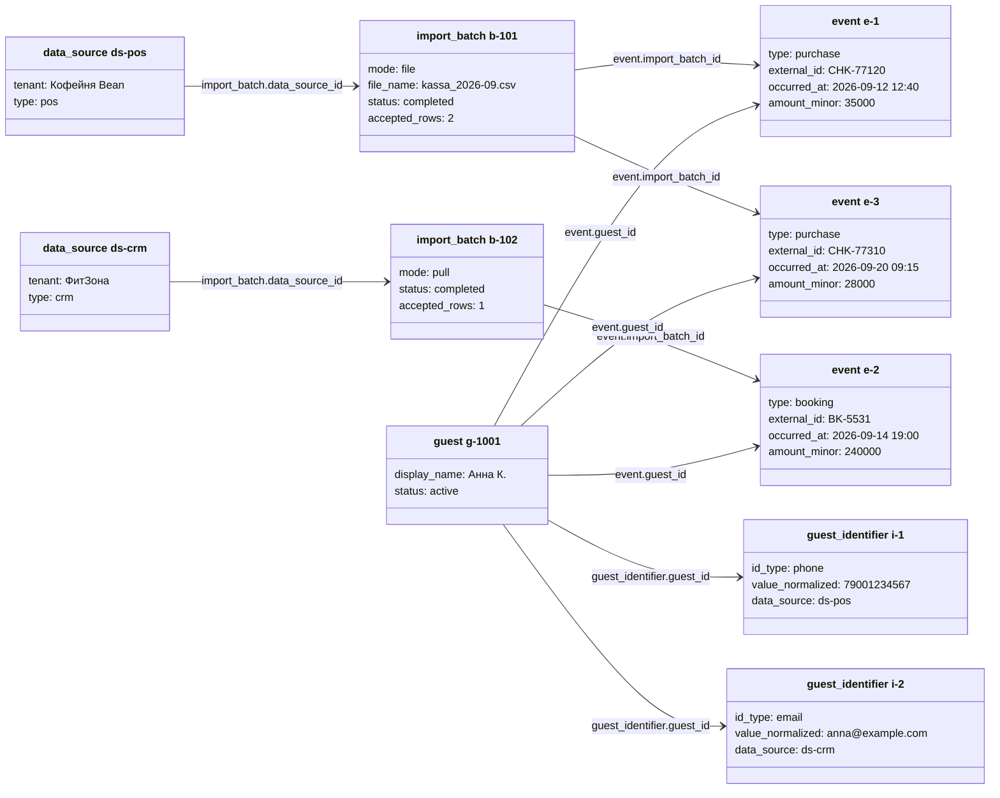
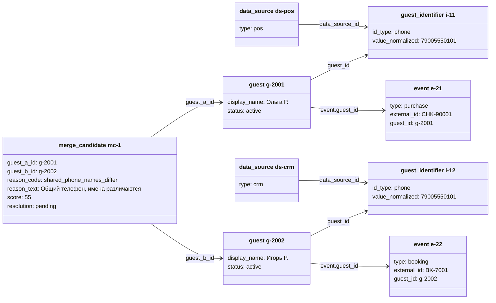
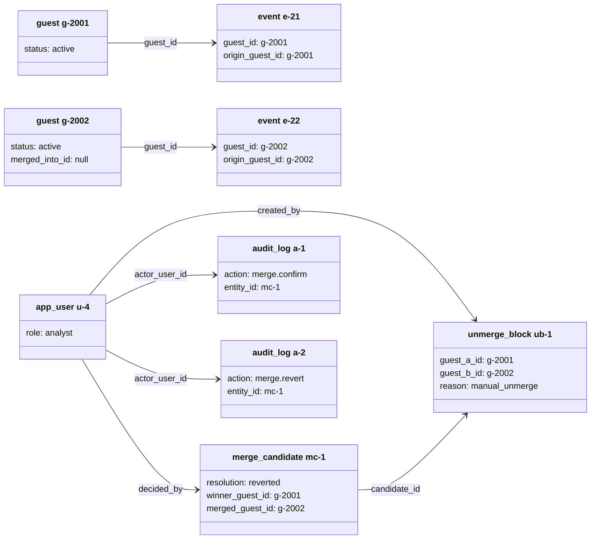
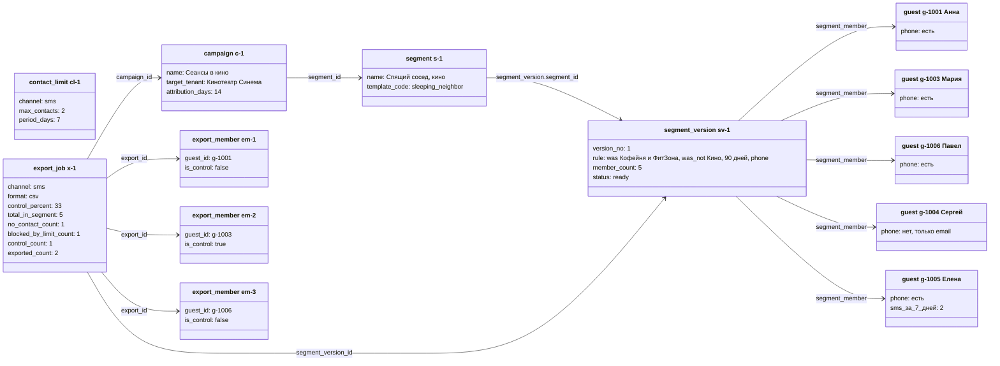
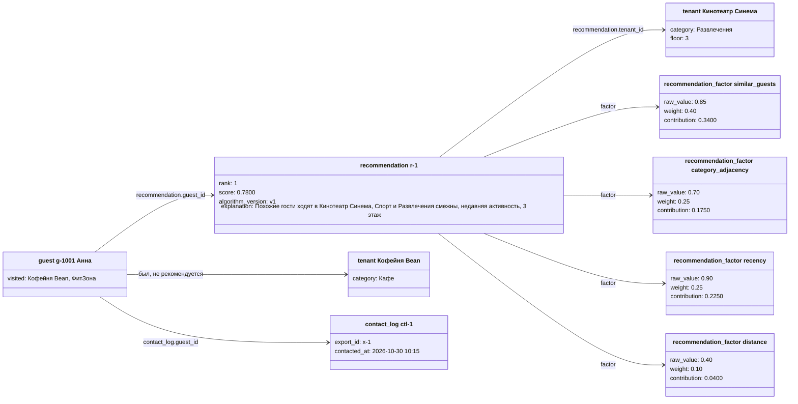

# 06. Object Diagrams (экземпляры данных)

Ограничение нотации. В Mermaid нет отдельной object diagram, поэтому экземпляры показаны через `classDiagram`: каждый «класс» — один экземпляр (строка таблицы), заголовок вида `таблица ид`, атрибуты — значения полей, стрелки — внешние ключи. Скобки в значениях не используются (в `classDiagram` они означают методы). Деньги в минимальных единицах (35000 = 350,00 RUB), даты в UTC. Общий набор арендаторов для всех сценариев: «Кофейня Bean» (категория Кафе, 1 этаж), «ФитЗона» (Спорт, 2 этаж), «Кинотеатр Синема» (Развлечения, 3 этаж).

## Сценарий (a): один гость, события из кассы и CRM склеены по телефону

Пояснение. Первая строка кассы (e-1) принесла телефон 79001234567: резолвер не нашёл такого ключа и создал гостя g-1001 с идентификатором i-1. Событие e-2 из CRM фитнеса содержит тот же телефон в другом написании (`+7 (900) 123-45-67`), после нормализации ключ найден, событие привязано к g-1001, а новый ключ — email — добавлен как i-2; автосклейка здесь не потребовалась, это поиск по ключу. В профиле видны три события у двух арендаторов, число посещённых арендаторов (`tenant_count`) равно 2. Повторная загрузка `kassa_2026-09.csv` вернёт 200 `duplicate=true` по sha256 файла, а любая другая загрузка с `CHK-77120` даст строку `duplicate` благодаря `UNIQUE(data_source_id, event_type_id, external_id)`. Match rate по этим трём событиям равен 100%.

| Элемент                 | Go-пакет / слой                                  | React-модуль        | API-контракт              |
| ----------------------- | ------------------------------------------------ | ------------------- | ------------------------- |
| import_batch, event     | `internal/ingestion`, `repository.EventRepo`     | `features/import`   | `GET /imports/{id}`       |
| guest, guest_identifier | `internal/identity` (`IdentityResolver.Resolve`) | `features/profiles` | `GET /guests/{id}`        |
| события в профиле       | `service.ProfileService`                         | `/guests/:guestId`  | `GET /guests/{id}/events` |

---

## Сценарий (b): спорная склейка в очереди и ручное разъединение

### (b1) Состояние: пара в очереди

Пояснение. Два профиля созданы из разных источников и делят один телефон, но имена различаются (например, один номер на семью). Резолвер не имеет права сливать такую пару автоматически, поэтому создал `merge_candidate` со статусом `pending`, причиной и оценкой 55; пара видна в очереди `/identity/queue` и не меняет профили. События и идентификаторы пока остаются у своих гостей, так что рассылка по телефону не придёт «чужому» человеку с чужой историей. Индекс очереди — `ix_merge_resolution (resolution, created_at)`.

### (b2) Состояние: объединили, затем разъединили вручную

Пояснение. Хронология: R-4 подтвердил пару (`POST /merge-candidates/mc-1/confirm`) — g-2002 стал `merged` с `merged_into_id = g-2001`, а e-22 и i-12 перешли к g-2001 (`origin_guest_id` остался g-2002); в `audit_log` появилась запись `merge.confirm` (a-1). Затем аналитик понял, что это разные люди, и вызвал `POST /merge-candidates/mc-1/revert`: строки с `origin_guest_id = g-2002` вернулись к g-2002, профиль снова `active`, кандидат получил `resolution = reverted`, создан `unmerge_block ub-1` и запись `merge.revert` (a-2) — всё в одной транзакции. На диаграмме показано конечное состояние. Новая загрузка с тем же общим телефоном пару не склеит и в очередь не вернёт, пока запрет не снят `DELETE /unmerge-blocks/ub-1`.

| Элемент         | Go-пакет / слой                                                        | React-модуль                            | API-контракт                                                              |
| --------------- | ---------------------------------------------------------------------- | --------------------------------------- | ------------------------------------------------------------------------- |
| merge_candidate | `internal/identity` (`MergeExecutor`), `repository.MergeCandidateRepo` | `features/profiles` (`/identity/queue`) | `GET /merge-candidates`, `POST /merge-candidates/{id}/confirm`, `/revert` |
| unmerge_block   | `repository.UnmergeBlockRepo`                                          | то же                                   | `GET /unmerge-blocks`, `DELETE /unmerge-blocks/{id}`                      |
| audit_log       | `service.AuditService`                                                 | `features/admin`                        | `GET /audit-logs?entity_id=mc-1`                                          |

---

## Сценарий (c): сегмент «Спящий сосед», рекомендация и выгрузка с контрольной группой

### (c1) Сегмент и выгрузка

Сегмент: «был в Кофейне Bean и ФитЗоне за 90 дней, но не был в Кинотеатре Синема, есть телефон для SMS». Лимит: не более 2 SMS за 7 дней. Выгрузка: канал `sms`, контрольная группа 33%.

Пояснение. В версии 1 сегмента пять гостей. При создании выгрузки сервис сначала отсекает гостей без телефона (g-1004, `no_contact_count = 1`), затем применяет лимит `cl-1`: у g-1005 уже два SMS за 7 дней, поэтому она исключена (`blocked_by_limit_count = 1`). Из трёх допустимых один гость (33%) детерминированно по `control_seed` отнесён в контрольную группу (g-1003, `is_control = true`); остальные двое (g-1001, g-1006) попадут в CSV. `contact_log` создаётся только для получателей, поэтому у g-1003 контакта нет и его визиты в Кинотеатр за 14 дней станут базой для расчёта инкремента. Лимит учтён до фиксации счётчиков, `exported_count + control_count + no_contact_count + blocked_by_limit_count = total_in_segment` (2 + 1 + 1 + 1 = 5).

### (c2) Рекомендация гостя g-1001 и контакт

Пояснение. Для g-1001 кандидатами считаются только арендаторы, где она ещё не была, поэтому Кофейня Bean и ФитЗона в списке отсутствуют. Первая рекомендация — Кинотеатр Синема: оценка 0,78 складывается из вкладов факторов (похожие гости 0,34, смежность категорий 0,175, свежесть 0,225, расстояние и этаж 0,04; приоритет арендатора нейтральный и вклада не даёт); текст обоснования хранится снимком в `explanation`. Прямые конкуренты не исключаются, а понижаются фактором `competitor_penalty` — в примере такого кандидата в топ-3 не оказалось из-за низкой суммы, а не из-за фильтра (A-18, D-34). После выгрузки x-1 создана запись `contact_log` для g-1001, которая учитывается лимитом контактов и конверсией (визит в кино до 2026-11-13 — окно 14 дней по умолчанию, `campaign.attribution_days`). Диаграмма иллюстрирует инвариант: `recommendation.tenant_id` ∉ множества арендаторов событий гостя.

| Элемент                                               | Go-пакет / слой                                  | React-модуль               | API-контракт                                                                               |
| ----------------------------------------------------- | ------------------------------------------------ | -------------------------- | ------------------------------------------------------------------------------------------ |
| segment, segment_version, segment_member              | `internal/segments` (`SegmentEvaluator`)         | `features/segments`        | `POST /segments`, `GET /segments/{id}/members`                                             |
| contact_limit, export_job, export_member, contact_log | `internal/export`, `service.ContactLimitService` | `features/export`          | `POST /exports/preview`, `POST /exports` (`Idempotency-Key`), `GET /exports/{id}/download` |
| campaign                                              | `service.CampaignService`                        | `features/export`          | `GET /campaigns/{id}/results`                                                              |
| recommendation, recommendation_factor                 | `internal/recommend` (`Recommender`, `Scorer`)   | `features/recommendations` | `GET /guests/{id}/recommendations`                                                         |

## Чекпойнт

Создано: 3 сценария (a, b1–b2, c1–c2) с экземплярами E-1, E-2, E-3, E-4, E-5, E-8, E-10, E-11, E-12, E-13, E-15, E-16, E-17, E-18, E-19, E-20, E-21. Использованы эндпоинты из реестра; инварианты: нет посещённых мест в рекомендациях, только гости с телефоном в SMS-выгрузке, сумма счётчиков выгрузки равна размеру сегмента.
