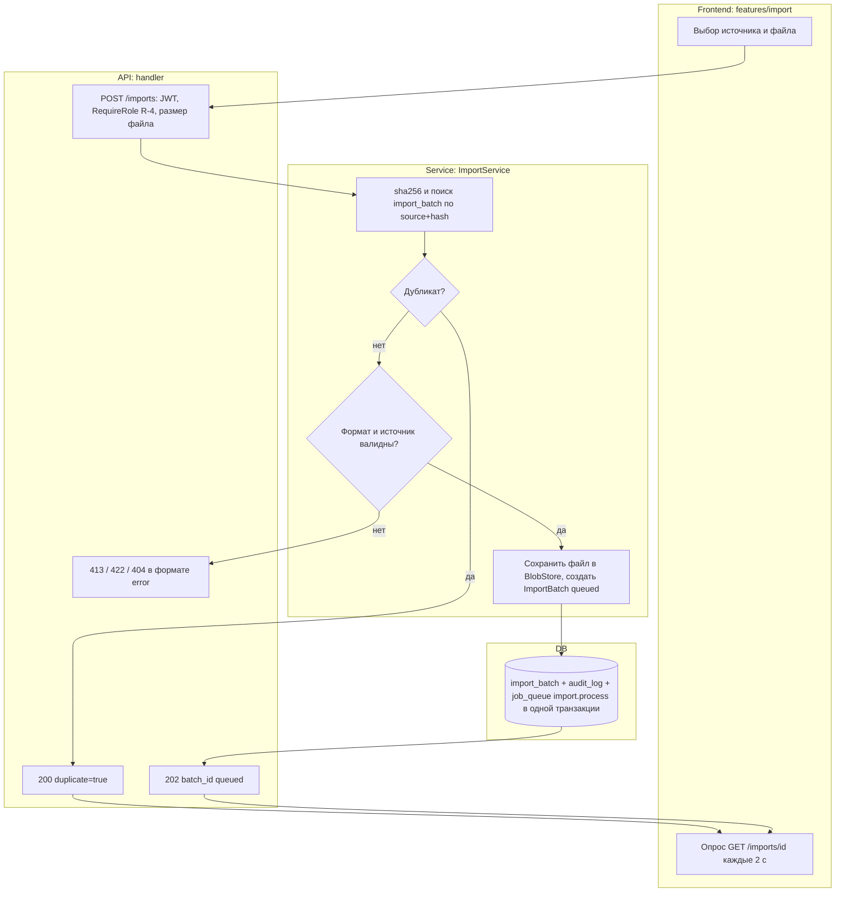
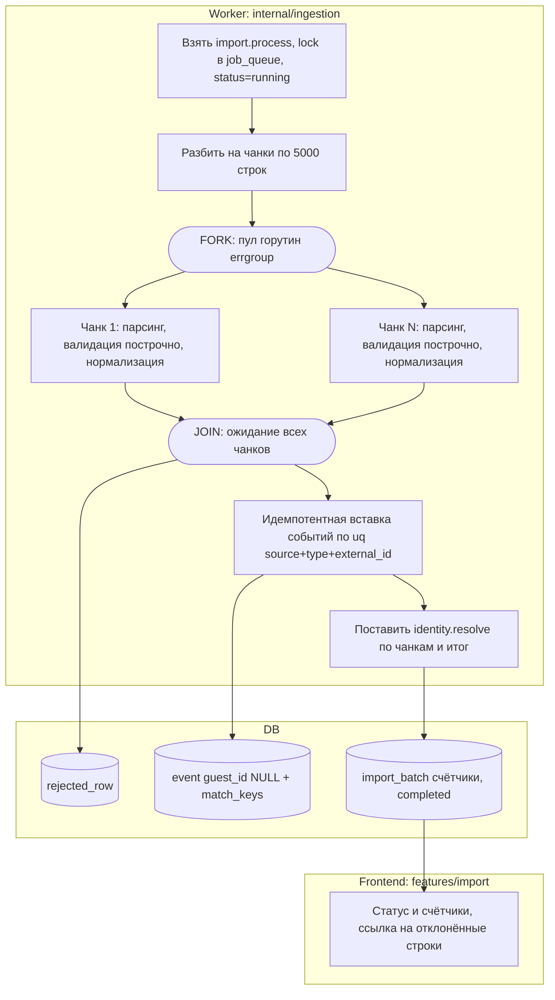
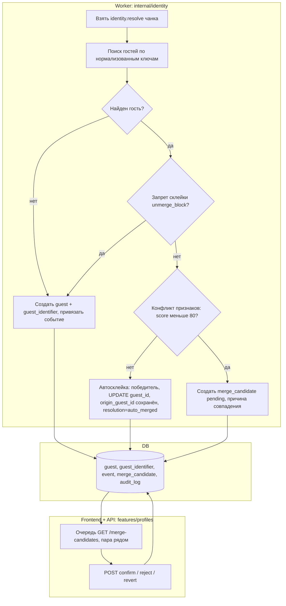
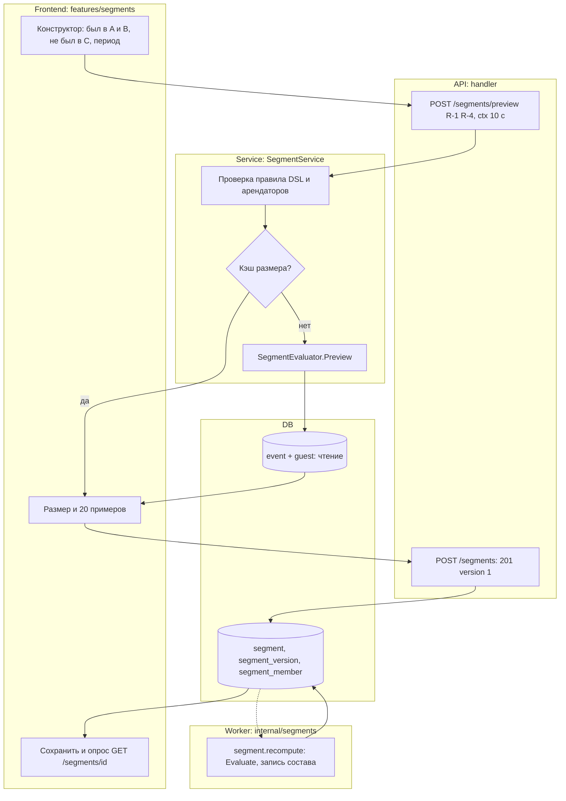
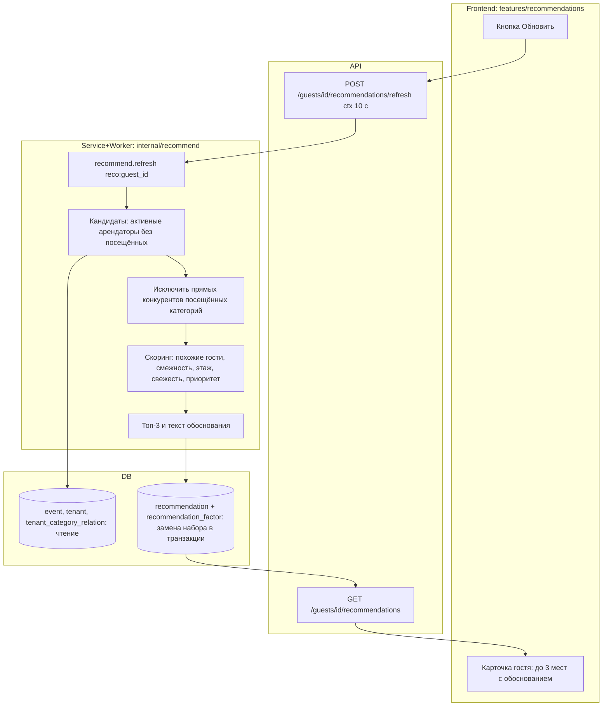
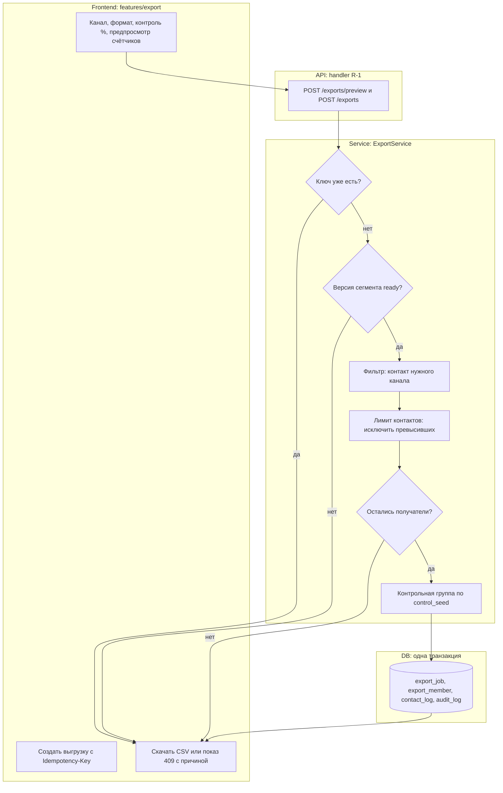

# 08. Activity Diagrams (swimlanes)

Mermaid не имеет нативных swimlanes: используется `flowchart TB`, дорожки — `subgraph` (Frontend / API / Service / Worker / DB), fork/join — тонкие узлы-«шины» `FORK`/`JOIN`, ромбы — решения. Ограничение: порядок дорожек на рендере определяет движок, поэтому направление стрелок важнее расположения. Каждая диаграмма ≤ ~15 узлов; импорт разбит на AD-1a (приём) и AD-1b (обработка). Всё опирается на `appendix/endpoint-registry.md` (эндпоинты, задания очереди) и `appendix/ddl.sql` (таблицы). Изоляция R-3: ни в одном из потоков R-3 не участвует, кроме собственных агрегатов (UC-8); `tenant_id` из JWT проверяется в `service` и подставляется фильтром в `repository` (см. 07 §3).

Общие обозначения: `ctx` — `context.Context` с дедлайном и `request_id`; все запросы к БД и вызовы воркеров принимают `ctx`.

## AD-1a. Импорт файла: приём (UC-1, US-1)

Пояснение. Приём файла синхронный и короткий: хэш считается потоково, дубликат (тот же `file_hash` для того же `data_source_id`, уникальный индекс `UNIQUE(data_source_id, file_hash)`) возвращает 200 с существующей загрузкой и `duplicate=true` (D-9), новых событий не создаётся. Для нового файла файл сохраняется в `BlobStore` (D-28), а запись `import_batch`, аудит и задание `import.process` с `dedup_key=import:{batch_id}` пишутся в одной транзакции, чтобы не потерять задание при сбое. Ответ 202 возвращается сразу; интерфейс опрашивает статус. Ошибки: 413 (>100 тыс. строк или >лимита размера), 422 (неверный формат/кодировка), 404 (источник не найден), 403 для чужой роли. Для R-3 эндпоинт закрыт.

| Элемент | Go-пакет / слой | React-модуль | API-контракт |
|---|---|---|---|
| F1 Форма загрузки | — | `features/import` (UploadForm) | multipart `data_source_id`, `file` |
| F2 Опрос статуса | — | `features/import` (BatchStatus, TanStack Query `refetchInterval` 2 с) | `GET /imports/{id}`: `status,total,accepted,rejected,duplicate` |
| A1 Приём | `handler.ImportHandler`, `platform/auth` (RequireRole) | `api/` (клиент) | `POST /imports` → 202/200/400/404/413/422 |
| S1–S4 | `service.ImportService`, `repository.ImportBatchRepo`, `platform/storage` | — | — |
| D1 Транзакция | `repository` (`ImportBatchRepo`, `AuditRepo`, `JobQueueRepo`) | — | таблицы `import_batch`, `audit_log`, `job_queue` |

## AD-1b. Импорт файла: обработка воркером с fork/join (UC-1, UC-6, UC-12)

Пояснение. Парсинг, построчная валидация (даты, сумма, `external_id`, ключи) и нормализация ключей (`identity.Normalize`: телефон E.164, email в нижнем регистре) независимы по чанкам и выполняются параллельно на пуле горутин внутри одного задания (D-24); ошибочные строки накапливаются с номером и кодом и после JOIN пишутся пачкой в `rejected_row`. После JOIN события вставляются одним писателем (SQLite допускает одного писателя): конфликт по `UNIQUE(data_source_id, event_type_id, external_id)` игнорируется и считается как `duplicate`, так что `accepted + rejected + duplicate = total`. События сохраняются с `guest_id=NULL` и `match_keys`; привязку выполняют задания `identity.resolve` (AD-2), после чего публикуются пересчёты сегментов и рекомендаций (UC-6, AD-3, AD-4). Все операции принимают `ctx` задания; при отмене или рестарте задание возвращается в очередь и безопасно повторяется благодаря идемпотентности. Статус `completed_with_errors` ставится, если `rejected > 0`.

| Элемент | Go-пакет / слой | React-модуль | API-контракт |
|---|---|---|---|
| W1 Захват задания | `cmd/worker`, `platform/queue` (`Queue`) | — | очередь `import.process`, `dedup_key import:{batch_id}` |
| W2–W4 Чанки | `internal/ingestion` (`SourceConnector.Open`, `SourceConnector.Pull`, `RowValidator`, `Normalizer`) | — | — |
| FORK/JOIN | `internal/ingestion` (errgroup, ограничение 4 горутины, Q-22) | — | — |
| W5 Вставка | `repository.EventRepo` (`InsertBatchIgnoreDuplicates`) | — | таблица `event` |
| W6 Постановка | `platform/queue` | — | очереди `identity.resolve` (`resolve:{batch_id}:{chunk}`) |
| D1 Ошибки | `repository.RejectedRowRepo` | `features/import` (RejectedTable) | `GET /imports/{id}/rejected-rows` (R-4) |
| F1 Итог | — | `features/import` (BatchStatus) | `GET /imports/{id}` (R-4, R-2) |

## AD-2. Автосклейка и спорная склейка (UC-12, UC-11, US-11)

Пояснение. Для каждого события воркер ищет гостей по надёжным ключам (телефон, email, карта). Совпадение с одним гостем просто привязывает событие. Если ключ принадлежит двум разным гостям, проверяется запрет склейки (E-12): пара под запретом остаётся раздельной, событие привязывается к ближайшему гостю, а кандидат не создаётся. Без запрета и без конфликта (имена похожи, score ≥ 80, Q-12) выполняется автосклейка в одной транзакции: события и идентификаторы переходят победителю, `origin_guest_id` хранит прежнего владельца (D-5), проигравший получает `status=merged` и `merged_into_id`, пишутся `merge_candidate` с `auto_merged` и запись аудита. При конфликте создаётся `merge_candidate pending` и ждёт R-4: confirm выполняет ту же склейку, reject и revert создают запрет и возвращают события по `origin_guest_id` (SD-6). Параллельный resolve по одному ключу исключён сериализацией (D-23).

| Элемент | Go-пакет / слой | React-модуль | API-контракт |
|---|---|---|---|
| W1 Задание | `cmd/worker`, `internal/identity` | — | очередь `identity.resolve` |
| W2–W8 | `identity.IdentityResolver`, `identity.Policy`, `repository.GuestRepo`, `GuestIdentifierRepo`, `EventRepo`, `MergeCandidateRepo`, `UnmergeBlockRepo`, `AuditRepo` | — | таблицы `guest`, `guest_identifier`, `event`, `merge_candidate`, `unmerge_block`, `audit_log` |
| F1 Очередь | `handler.IdentityHandler`, `service.IdentityService` | `features/profiles` (MergeQueue, MergeCompare) | `GET /merge-candidates`, `GET /merge-candidates/{id}` (R-4, R-1 чтение) |
| F2 Решение | `service.IdentityService` | `features/profiles` | `POST /merge-candidates/{id}/confirm|reject|revert` (R-4), 409 если уже решено |

## AD-3. Построение сегмента с предпросмотром (UC-3, UC-13, US-3)

Пояснение. Каждое изменение условий вызывает предпросмотр с дебаунсом: `service` проверяет правило (DSL с массивами `was`, `was_not`, `period_days`, `require_contact`), смотрит кэш размера по хэшу правила и при промахе вызывает `SegmentEvaluator.Preview`, который считает размер и 20 примеров прямо по `event` без записи. Ограничение времени 10 с задаётся через `context.WithTimeout`; при превышении клиент получает 504 и подсказку сузить правило. Сохранение создаёт `segment_version` №1 со статусом `pending`, пишет аудит и ставит `segment.recompute` (`segment:{id}:{version_no}`) — ответ 201 приходит сразу. Воркер вычисляет состав и записывает `segment_member`, `member_count`, `computed_at`, после чего статус `ready`; интерфейс опросом видит готовность. Правка правила создаёт новую версию, старая неизменяема (D-7). Предустановленные шаблоны («Спящий сосед» и др.) — те же правила с `template_code`.

| Элемент | Go-пакет / слой | React-модуль | API-контракт |
|---|---|---|---|
| F1 Конструктор | — | `features/segments` (RuleBuilder, React Hook Form) | — |
| F2 Предпросмотр | — | `features/segments` (PreviewPanel) | `POST /segments/preview` → `{size, examples[20]}`, 400, 504 |
| A2 Сохранение | `handler.SegmentHandler`, `service.SegmentService` | `features/segments` | `POST /segments` → 201 `{id, version_no:1, status:"pending"}` |
| S2 Кэш | `platform/cache` (in-memory TTL, D-27) | — | — |
| S3 / W1 | `segments.SegmentEvaluator`, `repository.SegmentRepo`, `SegmentVersionRepo`, `SegmentMemberRepo` | — | очередь `segment.recompute` |
| F3 Статус | — | `features/segments` (SegmentCard) | `GET /segments/{id}`: `status,member_count,computed_at` |

## AD-4. Формирование рекомендации (UC-15, UC-4, UC-6, US-4)

Пояснение. Пересчёт запускается автоматически после изменения ленты гостя (UC-6, задание `recommend.refresh` с `dedup_key reco:{guest_id}` схлопывает лишние запуски) или вручную кнопкой (синхронный вызов `Recommender.Refresh` с таймаутом 10 с, иначе 504). Кандидаты — активные арендаторы, где гость ещё не был, поэтому посещённые места не попадают в выдачу. Прямые конкуренты категорий посещённых мест исключаются, остальные получают взвешенную сумму факторов (веса из конфигурации, версия алгоритма пишется в `recommendation.algorithm_version`, D-15). Остаются три лучших; для каждой сохраняется текст обоснования и разложение по факторам (`recommendation_factor`). Набор заменяется транзакцией, чтобы чтение никогда не видело неполный набор. Чтение через `GET` быстрое и не пересчитывает (D-12).

| Элемент | Go-пакет / слой | React-модуль | API-контракт |
|---|---|---|---|
| F1 Список | — | `features/recommendations` (RecommendationList, WhyPopover) | `GET /guests/{id}/recommendations` → `[{tenant_id, rank, score, explanation}]` |
| F2 Обновить | — | `features/recommendations` | `POST /guests/{id}/recommendations/refresh` → 200/404/504 |
| W1 Задание | `cmd/worker`, `platform/queue` | — | очередь `recommend.refresh` |
| W2–W5 | `recommend.Recommender`, `recommend.Scorer`, `service.RecommendationService` | — | — |
| D1/D2 | `repository.RecommendationRepo`, `EventRepo`, `TenantRepo`, `TenantCategoryRelationRepo` | — | таблицы `recommendation`, `recommendation_factor` |

## AD-5. Выгрузка сегмента с лимитом контактов и контрольной группой (UC-5, UC-10, US-5, US-10)

Пояснение. Предпросмотр возвращает четыре числа: в сегменте, с контактом канала, заблокировано лимитом, в контрольной группе. Создание требует заголовок `Idempotency-Key`: повтор с тем же ключом возвращает ту же выгрузку, а не создаёт новую. Если версия сегмента не `ready`, возвращается 409. Дальше исключаются гости без идентификатора нужного канала (`sms` и `push` — телефон, `email` — email, Q-21) и гости, превысившие самое строгое из правил `contact_limit` (общее и по каналу, Q-13); если не осталось ни одного получателя, ответ 409 с разбивкой причин. Контрольная группа выбирается детерминированно по `control_seed` (D-17) и не попадает в CSV и в `contact_log`. Запись `export_job`, `export_member`, `contact_log` и аудита идёт одной транзакцией с повторной проверкой лимита внутри неё (D-26). Малые выгрузки (до 20 000 членов) строятся синхронно (201), большие — заданием `export.build` (202, Q-23).

| Элемент | Go-пакет / слой | React-модуль | API-контракт |
|---|---|---|---|
| F1 Предпросмотр | — | `features/export` (ExportWizard, CountsCard) | `POST /exports/preview` → `{in_segment, with_contact, blocked_by_limit, control}` |
| F2 Создать | — | `features/export` | `POST /exports` + `Idempotency-Key` → 201/202/409/504 |
| F3 Результат | — | `features/export` (ExportResult, DownloadButton) | `GET /exports/{id}/download` (CSV), `GET /exports/{id}/members` (API) |
| S1–S6 | `service.ExportService`, `service.ContactLimitService`, `export.ExportChannel` (SMS/Push/Email × CSV/API) | — | — |
| D1 | `repository.ExportRepo`, `ExportMemberRepo`, `ContactLogRepo`, `ContactLimitRepo`, `AuditRepo` | — | таблицы `export_job`, `export_member`, `contact_log`, `audit_log` |

## Чекпойнт
Создано: AD-1a, AD-1b, AD-2, AD-3, AD-4, AD-5 (6 диаграмм, 5 activity-потоков). Использованы: R-1, R-4, R-6; UC-1, UC-3, UC-4, UC-5, UC-6, UC-10, UC-11, UC-12, UC-13, UC-15; E-2, E-3, E-10, E-11, E-12, E-13, E-14, E-15, E-16, E-17, E-18, E-19, E-21, T-1; очереди `import.process`, `identity.resolve`, `segment.recompute`, `recommend.refresh`, `export.build`. Новые решения: D-23, D-24, D-26, D-27, D-28; вопросы: Q-21, Q-22, Q-23.
