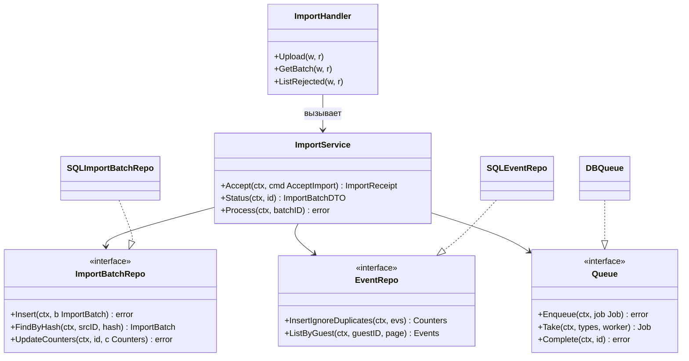
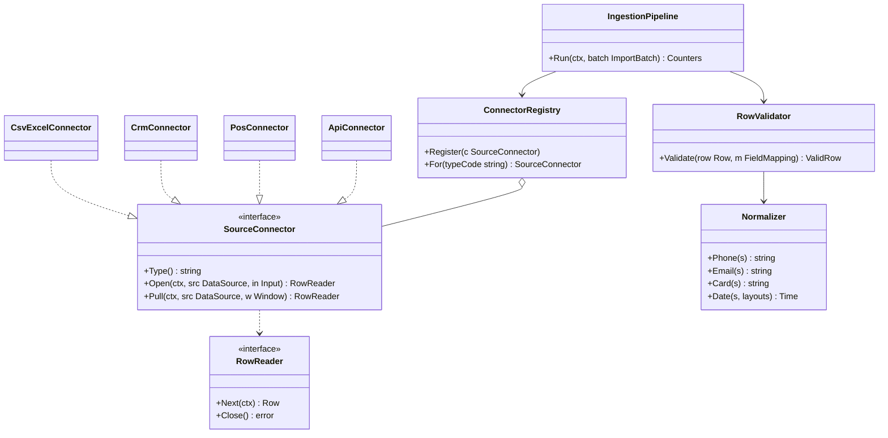
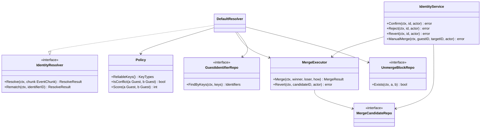
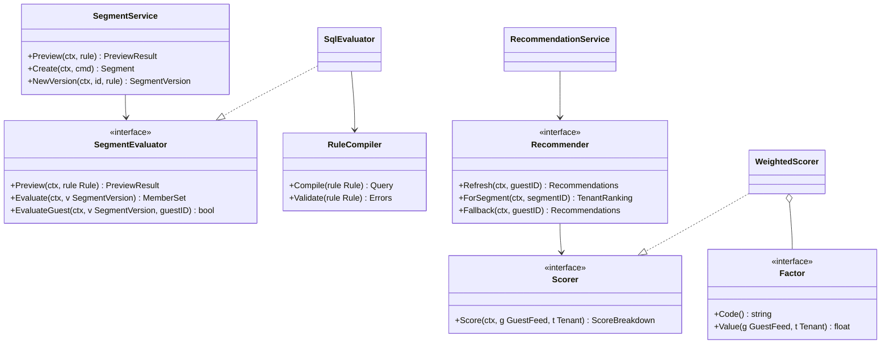
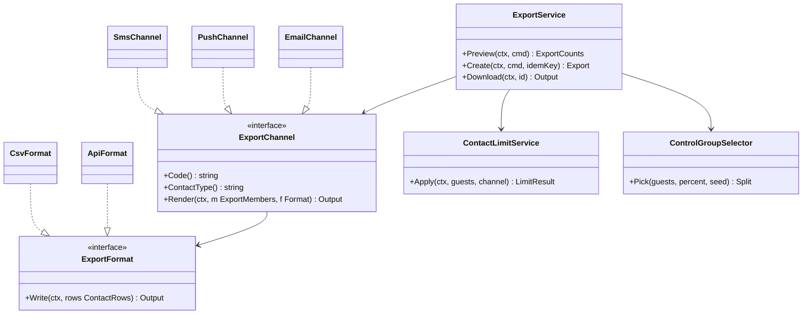
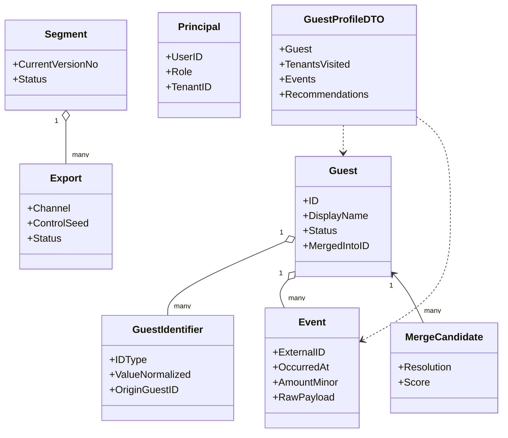

# 10. Class Diagrams

Диаграммы показывают контракты (Go-интерфейсы, `<<interface>>`) и их реализации, а не код. Правило слоёв: `handler → service → repository`, зависимости направлены внутрь к `domain`; интерфейсы репозиториев и портов объявляются в `internal/domain` (потребитель владеет контрактом), реализации — в `internal/repository`, `internal/ingestion`, `internal/export` и др. Во всех методах первым параметром идёт `ctx context.Context` (на диаграммах опущен для краткости, где не меняет смысл). Имена совпадают с глоссарием (02) и сигнатурами из 04. Mermaid: в `classDiagram` нет пакетов и приватности Go, поэтому слой указан в пояснении и в таблице. Из-за лимита ~15 узлов модель разбита на шесть диаграмм: CL-1 слои, CL-2 ingestion, CL-3 identity, CL-4 segments и recommend, CL-5 export, CL-6 domain и DTO.

## CL-1. Слои на примере импорта и профиля

Пояснение. `Handler` только разбирает HTTP, проверяет роль и маппит DTO; бизнес-правила (дубликат, формат, ограничения) живут в `Service`; `Repository` скрывает SQL и диалект (SQLite/PostgreSQL), поэтому смена СУБД не затрагивает верхние слои. `Queue` — порт с реализацией на таблице `job_queue` (D-8) и возможной заменой на брокер. Тот же шаблон применяется ко всем остальным сервисам (`ProfileService`, `SegmentService`, `ExportService`, …).

| Элемент                              | Go-пакет / слой                                                   | React-модуль                | API-контракт                                                            |
| ------------------------------------ | ----------------------------------------------------------------- | --------------------------- | ----------------------------------------------------------------------- |
| ImportHandler                        | `internal/handler`                                                | `features/import`           | `POST /imports`, `GET /imports/{id}`, `GET /imports/{id}/rejected-rows` |
| ImportService                        | `internal/service`                                                | —                           | —                                                                       |
| ImportBatchRepo / SQLImportBatchRepo | `internal/domain` (интерфейс), `internal/repository` (реализация) | —                           | таблица `import_batch`                                                  |
| EventRepo / SQLEventRepo             | `internal/domain`, `internal/repository`                          | `features/profiles` (лента) | таблица `event`, `GET /guests/{id}/events`                              |
| Queue / DBQueue                      | `internal/domain`, `internal/platform/queue`                      | —                           | таблица `job_queue`                                                     |

## CL-2. Ingestion: SourceConnector и его реализации

Пояснение. Каждый формат источника — одна реализация `SourceConnector`, зарегистрированная в `ConnectorRegistry` по коду типа из справочника `data_source_type`; `IngestionPipeline` не знает о форматах и работает с потоком `Row`. `Open` обслуживает загруженный файл, `Pull` — API-источник с окном времени. Добавление нового формата (например, 1С) сводится к новой реализации и записи в справочнике, а валидатор, нормализатор и конвейер не меняются (Q-7). Нормализатор общий с `identity`, чтобы ключи сравнивались одинаково.

| Элемент                                                     | Go-пакет / слой                                                      | React-модуль                                           | API-контракт                                                                             |
| ----------------------------------------------------------- | -------------------------------------------------------------------- | ------------------------------------------------------ | ---------------------------------------------------------------------------------------- |
| SourceConnector, RowReader                                  | `internal/ingestion` (интерфейс)                                     | —                                                      | —                                                                                        |
| CsvExcelConnector, CrmConnector, PosConnector, ApiConnector | `internal/ingestion/connector`                                       | `features/admin` (выбор типа источника, маппинг полей) | `data_source_type.code`: `csv_excel`, `crm`, `pos`, `api`; `GET/POST /data-source-types` |
| ConnectorRegistry                                           | `internal/ingestion`                                                 | —                                                      | —                                                                                        |
| RowValidator, Normalizer                                    | `internal/ingestion`, `internal/identity/normalize` (чистые функции) | `features/import` (RejectedTable, коды причин)         | `rejected_row.error_code`                                                                |
| IngestionPipeline                                           | `internal/ingestion`                                                 | `features/import`                                      | очереди `import.process`, `connector.pull`                                               |

## CL-3. Identity: IdentityResolver и склейка

Пояснение. `IdentityResolver` вызывается воркером для чанка событий; `Policy` инкапсулирует правила надёжных ключей и порог конфликта (Q-12), поэтому смена порога не затрагивает схему. `MergeExecutor` — единственный код, который переписывает `guest_id` и выставляет `origin_guest_id`; им пользуются и автосклейка, и ручные операции `IdentityService`, что гарантирует одинаковую обратимость (D-5, D-25). `UnmergeBlockRepo.Exists` проверяется перед любой склейкой. Все изменения идут в одной транзакции вместе с записью аудита.

| Элемент                                                   | Go-пакет / слой                           | React-модуль                        | API-контракт                                                                          |
| --------------------------------------------------------- | ----------------------------------------- | ----------------------------------- | ------------------------------------------------------------------------------------- |
| IdentityResolver, DefaultResolver, Policy, MergeExecutor  | `internal/identity`                       | —                                   | очередь `identity.resolve`, `identity.rematch`                                        |
| IdentityService                                           | `internal/service`                        | `features/profiles`                 | `POST /merge-candidates/{id}/confirm                                                  | reject | revert`, `POST /guests/{id}/merge` |
| MergeCandidateRepo, UnmergeBlockRepo, GuestIdentifierRepo | `internal/domain` + `internal/repository` | `features/profiles` (UnmergeBlocks) | таблицы `merge_candidate`, `unmerge_block`, `guest_identifier`; `GET /unmerge-blocks` |

## CL-4. Segments и Recommend

Пояснение. `SegmentEvaluator` один контракт для трёх режимов: предпросмотр без записи, полный пересчёт версии и проверка одного гостя при инкрементальном обновлении (UC-6). `RuleCompiler` переводит JSON-правило в параметризованный SQL, чтобы правило не превращалось в произвольный запрос. `Recommender` использует `Scorer`, составленный из независимых `Factor` (похожие гости, смежность категорий, этаж/расстояние, свежесть, приоритет арендатора, понижение конкурента), веса берутся из конфигурации (D-15); новый фактор — новая реализация. Уже посещённые места отфильтровываются до скоринга; прямые конкуренты не отсекаются, а понижаются фактором `competitor_penalty` (A-18, D-34). Для гостя без событий `Recommender` вызывает `Fallback` (A-21, D-37).

| Элемент                                      | Go-пакет / слой      | React-модуль               | API-контракт                                                             |
| -------------------------------------------- | -------------------- | -------------------------- | ------------------------------------------------------------------------ |
| SegmentEvaluator, SqlEvaluator, RuleCompiler | `internal/segments`  | `features/segments`        | `POST /segments/preview`, очередь `segment.recompute`                    |
| SegmentService                               | `internal/service`   | `features/segments`        | `POST /segments`, `PUT /segments/{id}`                                   |
| Recommender, Scorer, WeightedScorer, Factor  | `internal/recommend` | `features/recommendations` | очередь `recommend.refresh`, `POST /guests/{id}/recommendations/refresh` |
| RecommendationService                        | `internal/service`   | `features/recommendations` | `GET /guests/{id}/recommendations`, `GET /segments/{id}/recommendations` |

## CL-5. Export и ограничение контактов

Пояснение. Канал определяет, какой тип идентификатора считается контактом (`ContactType`: телефон для SMS и push, email для email, Q-21), формат — как отдаётся результат (CSV-файл или JSON API для провайдера, Q-20). `ExportService` оркестрирует: фильтр по контакту, `ContactLimitService` (самое строгое правило), `ControlGroupSelector` (детерминированно по `control_seed`, D-17) и транзакционную запись. Новый канал или формат — новая реализация без изменения сервиса; внешние провайдеры не вызываются, система только отдаёт данные.

| Элемент                                              | Go-пакет / слой    | React-модуль                     | API-контракт                                                     |
| ---------------------------------------------------- | ------------------ | -------------------------------- | ---------------------------------------------------------------- |
| ExportChannel, SmsChannel, PushChannel, EmailChannel | `internal/export`  | `features/export` (выбор канала) | `POST /exports` поле `channel`                                   |
| ExportFormat, CsvFormat, ApiFormat                   | `internal/export`  | `features/export`                | `GET /exports/{id}/download`, `GET /exports/{id}/members`        |
| ExportService, ContactLimitService                   | `internal/service` | `features/export`                | `POST /exports/preview`, `GET/POST/PATCH/DELETE /contact-limits` |
| ControlGroupSelector                                 | `internal/export`  | —                                | `export_member.is_control`                                       |

## CL-6. Domain и DTO

Пояснение. `domain` не зависит от HTTP и SQL: это структуры E-1…E-21 (показаны ключевые) и значения вроде `Principal`, `Counters`, `Window`. DTO (`GuestProfileDTO`, `ImportBatchDTO`, `TenantAggregates`) живут в `internal/handler/dto` и собираются сервисами, чтобы JSON-контракт не диктовал форму таблиц. Для R-3 существует отдельный DTO `TenantAggregates` без идентификаторов гостей — типовая гарантия, что строки гостей не могут попасть в ответ арендатору. `Principal` передаётся только через `context.Context`.

| Элемент                                                        | Go-пакет / слой                     | React-модуль                         | API-контракт                             |
| -------------------------------------------------------------- | ----------------------------------- | ------------------------------------ | ---------------------------------------- |
| Guest, GuestIdentifier, Event, MergeCandidate, Segment, Export | `internal/domain`                   | `features/*` (типы ответов в `api/`) | сущности E-1, E-10, E-2, E-11, E-3, E-16 |
| Principal                                                      | `internal/domain` + `platform/auth` | `auth/` (useAuth)                    | claims JWT, `GET /auth/me`               |
| GuestProfileDTO                                                | `internal/handler/dto`              | `features/profiles`                  | `GET /guests/{id}`                       |
| TenantAggregates DTO                                           | `internal/handler/dto`              | `features/tenant`                    | `GET /tenants/{id}/aggregates` (R-3 own) |

## Чекпойнт

Создано: CL-1…CL-6; интерфейсы `SourceConnector` (CSV/Excel, CRM, POS, API), `IdentityResolver`, `SegmentEvaluator`, `Recommender`, `ExportChannel`, а также `Queue`, `Scorer`, `Factor`, `ExportFormat`. Добавлены имена сервисов: `AuthService`, `IdentityService`, `RecommendationService`, `ExportService`, `ContactLimitService`. Решения: D-15, D-17, D-25, D-27; вопросы: Q-7, Q-20, Q-21.
