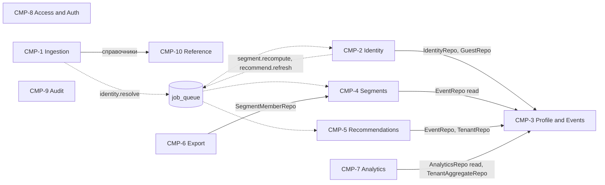
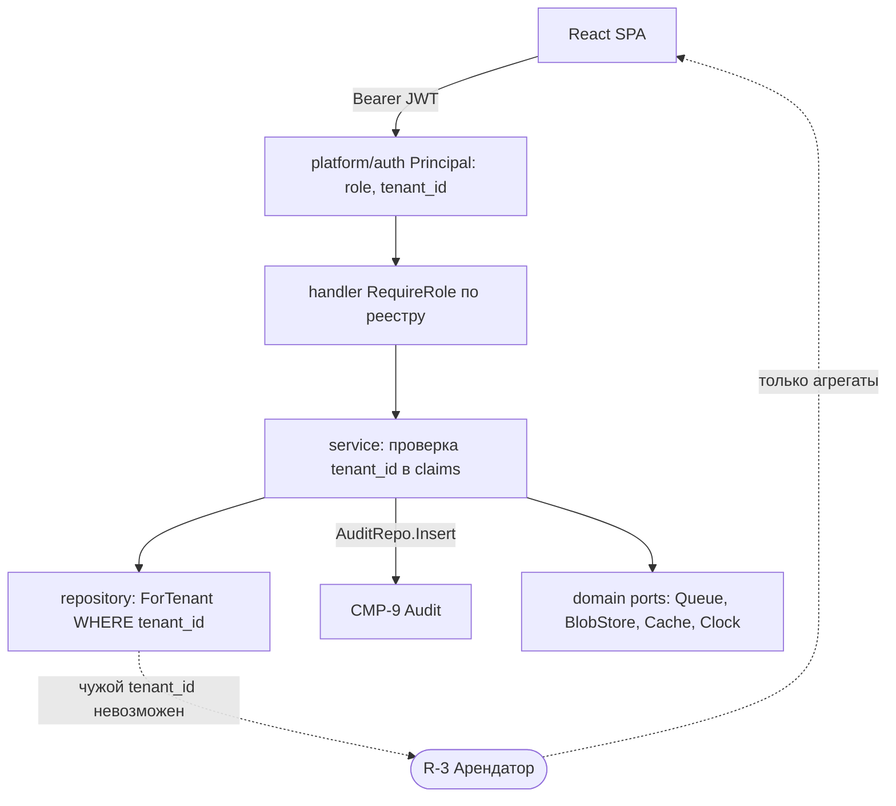

# 11. Component Diagram

Компоненты выделены по бизнес-способностям: CMP-1 Ingestion, CMP-2 Identity, CMP-3 Profile & Events, CMP-4 Segments, CMP-5 Recommendations, CMP-6 Export, CMP-7 Analytics, CMP-8 Access & Auth, CMP-9 Audit, CMP-10 Reference. Деревья пакетов и модулей: `appendix/go-package-tree.md`, `appendix/react-module-tree.md`. Mermaid не имеет нативных component-диаграмм: используется `flowchart` с узлами-компонентами; пунктир — асинхронная связь через очередь `job_queue`, сплошная — вызов через интерфейс (порт).

## CMP-D1. Компоненты и связи

Пояснение. Единственная связь между «записывающими» компонентами идёт через очередь: `Ingestion` не вызывает `Identity`, а ставит `identity.resolve`; `Identity` после привязки ставит пересчёт сегментов и рекомендаций. Это развязывает скорость приёма от скорости пересчёта и делает компоненты независимо масштабируемыми. `Profile and Events` — владелец данных гостей и событий, остальные читают их через репозитории-интерфейсы. `Access and Auth` и `Audit` — сквозные: каждый компонент получает `Principal` из `context.Context` и пишет аудит через `AuditService` (стрелки не показаны ради читаемости, см. CMP-D2). `Analytics` читает данные только на чтение; арендатору (R-3) доступны исключительно агрегаты через `TenantAggregateRepo` с фильтром `tenant_id`.

| Элемент | Go-пакет / слой | React-модуль | API-контракт |
|---|---|---|---|
| CMP-1 Ingestion | `internal/ingestion`, `service.ImportService` | `features/import` | `POST /imports`, `GET /imports*`, `POST /data-sources/{id}/sync`; очереди `import.process`, `connector.pull` |
| CMP-2 Identity | `internal/identity`, `service.IdentityService` | `features/profiles` (очередь склеек) | `/merge-candidates*`, `POST /guests/{id}/merge`, `/unmerge-blocks*`; очереди `identity.resolve`, `identity.rematch` |
| CMP-3 Profile and Events | `service.ProfileService`, `GuestRepo`, `EventRepo`, `GuestIdentifierRepo`, `ContactLogRepo` | `features/profiles` | `GET /guests*`, `DELETE /guests/{id}` |
| CMP-4 Segments | `internal/segments`, `service.SegmentService` | `features/segments` | `/segments*`, `/segment-templates`; очередь `segment.recompute` |
| CMP-5 Recommendations | `internal/recommend`, `service.RecommendationService` | `features/recommendations` | `GET /guests/{id}/recommendations`, `GET /segments/{id}/recommendations`; очередь `recommend.refresh` |
| CMP-6 Export | `internal/export`, `service.ExportService`, `ContactLimitService`, `CampaignService` | `features/export` | `/exports*`, `/contact-limits*`, `/campaigns*`; очередь `export.build` |
| CMP-7 Analytics | `DashboardService`, `TenantAggregateService`, `DataQualityService` | `features/dashboard`, `features/tenant`, `features/dq` | `/dashboard/*`, `GET /tenants/{id}/aggregates`, `/data-quality/*` |
| CMP-8 Access and Auth | `internal/platform/auth`, `AuthService`, `UserService` | `auth/`, `routes/`, `features/admin` (Users) | `/auth/*`, `/users*` |
| CMP-9 Audit | `AuditService`, `AuditRepo` | `features/admin` (AuditLog) | `GET /audit-logs` |
| CMP-10 Reference | `ReferenceService`, `TenantRepo` и др. справочные репозитории | `features/admin` | `/tenants*`, `/tenant-categories*`, `/projects*`, `/event-types*`, `/data-sources*`, `/data-source-types*` |

## CMP-D2. Сквозные порты и изоляция R-3

Пояснение. Все компоненты обращаются к инфраструктуре через порты из `domain` (очередь, хранилище файлов, кэш, часы), поэтому SQLite→PostgreSQL, локальный диск→объектное хранилище и in-memory→Redis заменяются без правок сервисов. Изоляция R-3 реализована трижды: `RequireRole` в `handler` ограничивает набор эндпоинтов, `service` сверяет `tenant_id` пути с claim (иначе 403, D-13), `repository` не имеет метода без `tenant_id` для данных арендатора. Аудит вызывается из service в той же транзакции, что и изменение.

| Элемент | Go-пакет / слой | React-модуль | API-контракт |
|---|---|---|---|
| Principal middleware | `internal/platform/auth` | `auth/`, `api/` | `Authorization: Bearer` |
| RequireRole | `internal/handler` | `routes/` (RoleGuard) | реестр: роли по эндпоинтам |
| Проверка tenant_id | `service.TenantAggregateService` | `features/tenant` | `GET /tenants/{id}/aggregates` → 403 |
| ForTenant | `repository.TenantAggregateRepo` | — | `event.tenant_id` |
| Порты | `internal/domain` + `platform/{queue,storage,cache}` | — | — |

## Порты и контракты между компонентами

| Порт (интерфейс) | Владелец (Go-пакет) | Реализации | Потребители |
|---|---|---|---|
| `SourceConnector` | `internal/ingestion` | CSV/Excel, CRM, POS, API | CMP-1 |
| `IdentityResolver` | `internal/identity` | `DefaultResolver` | воркер `identity.resolve` |
| `SegmentEvaluator` | `internal/segments` | `SqlEvaluator` | CMP-4, CMP-6 (проверка состава) |
| `Recommender`, `Scorer`, `Factor` | `internal/recommend` | `WeightedScorer` | CMP-5 |
| `ExportChannel`, `ExportFormat` | `internal/export` | SMS, Push, Email; CSV, API | CMP-6 |
| `Queue` | `internal/domain` | `DBQueue` (job_queue) | CMP-1, 2, 4, 5, 6 |
| `BlobStore`, `Cache`, `Clock` | `internal/domain` | локальный диск, in-memory, системное время | CMP-1, CMP-4 |
| `*Repo` | `internal/domain` | `internal/repository` | сервисы |

## Точки масштабирования

| Что | Как масштабируется | Условие / порог | Компонент |
|---|---|---|---|
| API | Stateless: JWT без серверной сессии, несколько инстансов за балансировщиком | Рост пользователей УК | CMP-8 и все handler |
| Очередь импорта | Несколько процессов `cmd/worker`, захват через `locked_by` и `run_after` | Файлы до 100 тыс. строк, 80–150 арендаторов | CMP-1, 2 |
| Кэш размеров сегментов | In-memory TTL 60 с по хэшу правила (D-27), замена на Redis через порт `Cache` | Несколько инстансов API | CMP-4 |
| SQLite → PostgreSQL | Те же миграции goose, диалектный слой в `sqlstore` | Более 1–3 млн событий (Q-11), несколько писателей | все репозитории |
| Реплика на чтение | Отдельный пул чтения для `AnalyticsRepo`, `SegmentEvaluator.Preview` | Нагрузка дашбордов и предпросмотров | CMP-7, CMP-4 |
| Партиционирование `event` | PG-миграция по `occurred_at` | Более нескольких млн событий | CMP-3 |
| Брокер вместо `job_queue` | Новая реализация `Queue` (D-8) | Тысячи заданий в минуту | CMP-1…CMP-6 |

## Матрица влияния изменений требований

| Изменение требований | Затронутые компоненты | Что меняется |
|---|---|---|
| Новый формат источника (например, 1С) | CMP-1, CMP-10 | Новая реализация `SourceConnector` + запись `data_source_type`; остальное без изменений |
| Новый тип события | CMP-10 (данные) | Запись в `event_type`; код только при новой логике присутствия. Так добавлены `top_up`, `usage`, `reversal` (A-20, D-36) |
| Новый тип идентификатора (Wi-Fi MAC, Q-3) | CMP-2, CMP-10 | Правило в `identity.Policy`, `id_type`; схема не меняется |
| Новый канал рассылки | CMP-6 | Реализация `ExportChannel`, значение `channel` (миграция CHECK, D-11) |
| Другой формат выгрузки провайдера (Q-20) | CMP-6 | Реализация `ExportFormat` |
| Новый фактор скоринга | CMP-5 | Реализация `Factor`, вес в конфигурации (D-15) |
| Новое условие правила сегмента | CMP-4 | Расширение `RuleCompiler` и DSL; старые версии правил читаются |
| Новая роль (Q-16) | CMP-8 | Значение `role` (миграция CHECK, D-10) и RequireRole |
| Расширение прав R-3 (Q-6) | CMP-7, CMP-8 | Новые эндпоинты + изоляция по сегментам; ядро не меняется |
| Другое определение конверсии (Q-9) | CMP-6, CMP-7 | Запросы метрик; схема та же |
| Реалтайм-обновление UI (D-22) | CMP-4, CMP-5 | SSE в `handler`; API остаётся stateless |
| Конкурент перестаёт понижаться и исключается жёстко (D-34) | CMP-5 | Значение коэффициента и флаг категории в конфигурации; схема та же |
| Внешние партнёры вне комплекса (A-22, D-38) | CMP-10, CMP-5 | Значение `tenant.kind`; фильтр в скоринге и в справочниках |

## Чекпойнт
Создано: CMP-D1, CMP-D2; компоненты CMP-1…CMP-10 (соответствие пакетам и модулям — в обоих деревьях); таблицы портов, масштабирования и влияния изменений. Использованы D-8, D-10, D-11, D-13, D-14, D-15, D-22, D-27, D-28; вопросы Q-3, Q-6, Q-9, Q-11, Q-16, Q-20.
