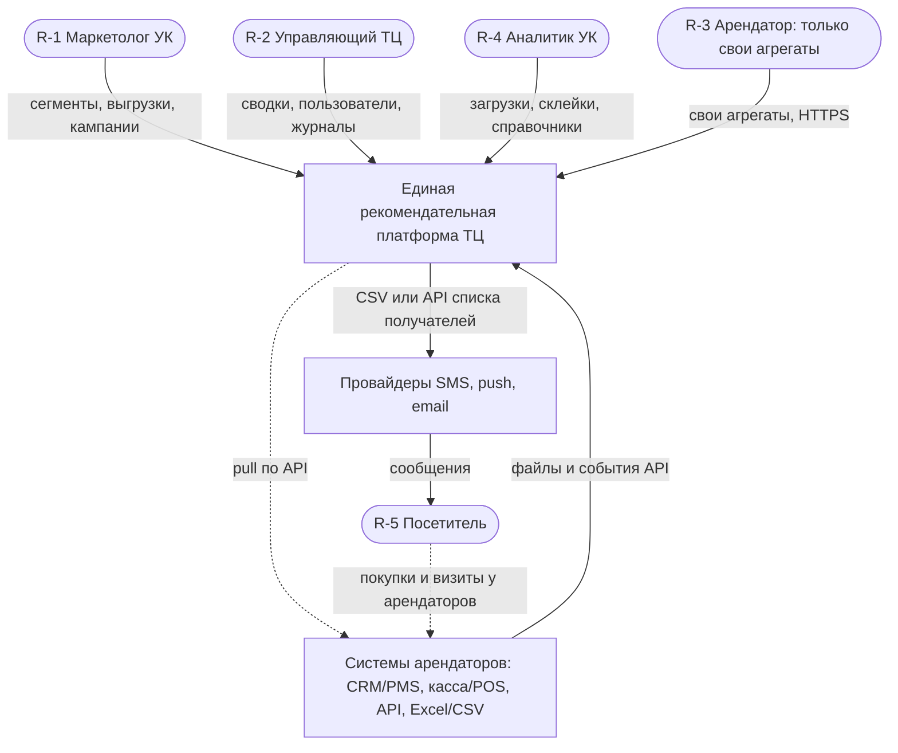
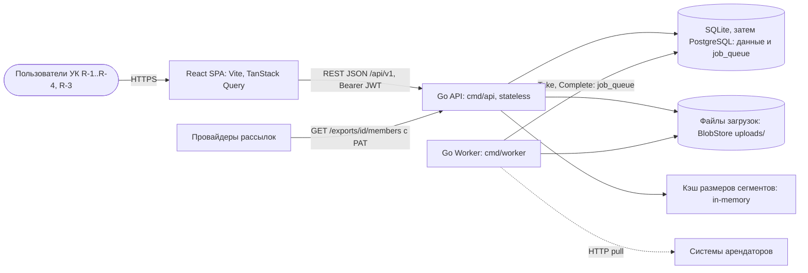
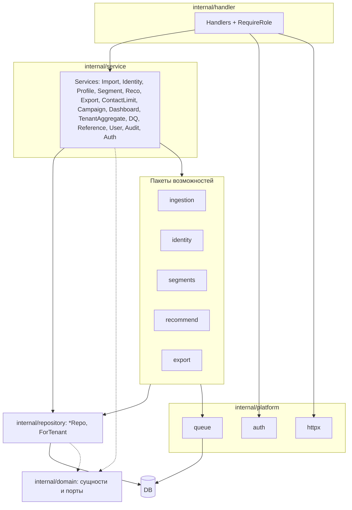
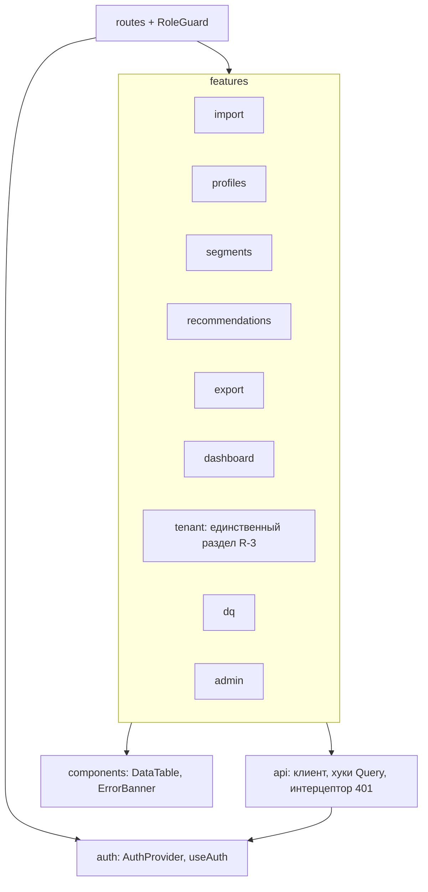
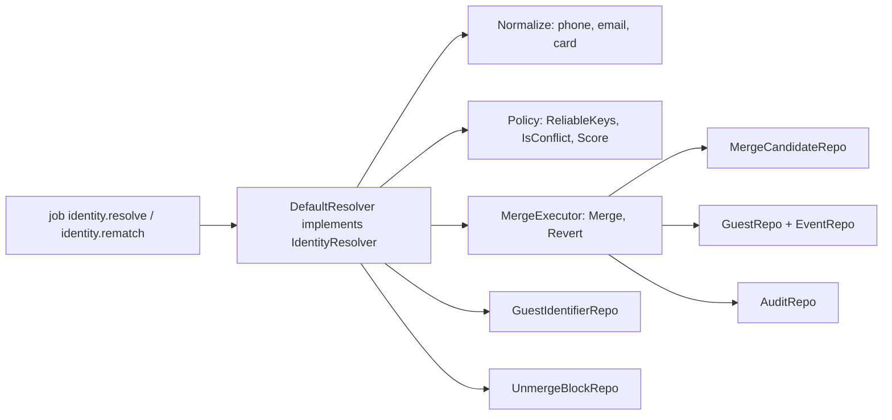

# 12. C4: Context, Container, Component, Code

Нативная нотация Mermaid `C4Context` экспериментальная и нестабильна, поэтому используется `flowchart`: прямоугольники — системы/контейнеры, «стадионы» — люди, цилиндры — хранилища, пунктир — исходящие/асинхронные связи. ID: C4-L1, C4-L2, C4-L3a (backend), C4-L3b (frontend), C4-L4 (identity). Согласовано с компонентами CMP-1…CMP-10 (`11-component-diagram.md`), последовательностями SD-1…SD-8 и потоками DFD (`13-dfd.md`).

## C4-L1. System Context

Пояснение. Платформа принимает данные арендаторов и превращает их в единый профиль, рекомендации и сегменты; это B2B2C-продукт: решает и платит УК (R-2), работает маркетолог (R-1) и аналитик (R-4), выгоду получает посетитель (R-5). Сообщения платформа сама не отправляет (допущение 0.3): она отдаёт получателей провайдерам через CSV или API, а провайдеры связываются с посетителем. Арендатор (R-3) получает только обезличенные агрегаты о себе и не видит данные других арендаторов; события посетителя возникают в системах арендаторов, откуда попадают в платформу.

| Элемент             | Go-пакет / слой                          | React-модуль                      | API-контракт                                              |
| ------------------- | ---------------------------------------- | --------------------------------- | --------------------------------------------------------- |
| Платформа           | `cmd/api`, `cmd/worker`                  | React SPA                         | `/api/v1/*`                                               |
| R-1…R-4             | —                                        | `auth/`, `routes/` (меню по роли) | `POST /auth/login`, `GET /auth/me`                        |
| R-3                 | `service.TenantAggregateService`         | `features/tenant`                 | `GET /tenants/{id}/aggregates` (own)                      |
| Системы арендаторов | `internal/ingestion` (`SourceConnector`) | `features/import`                 | `POST /imports`, `POST /data-sources/{id}/sync`           |
| Провайдеры          | `internal/export`                        | `features/export`                 | `GET /exports/{id}/download`, `GET /exports/{id}/members` |

## C4-L2. Container

Пояснение. SPA общается с backend только через REST. API не хранит состояние (JWT в заголовке), поэтому масштабируется горизонтально; тяжёлые операции (импорт, пересчёт сегментов, рекомендации, большие выгрузки) уходят в очередь, которую обслуживает отдельный процесс `Worker` из той же кодовой базы. Очередь — таблица `job_queue` в основной БД (D-8), поэтому отдельного брокера нет; кэш размеров — in-process (D-27), файлы загрузок — локальный каталог за интерфейсом `BlobStore` (D-28). Провайдеры в режиме API читают получателей выгрузки с персональным токеном R-1 (D-16, Q-24); арендатор R-3 использует тот же SPA, но маршруты ограничены одним разделом.

| Элемент         | Go-пакет / слой                                                                   | React-модуль                         | API-контракт                                                                                                                                  |
| --------------- | --------------------------------------------------------------------------------- | ------------------------------------ | --------------------------------------------------------------------------------------------------------------------------------------------- |
| React SPA       | —                                                                                 | `src/` (api, auth, routes, features) | все `/api/v1/*`                                                                                                                               |
| Go API          | `cmd/api`, `internal/handler`, `internal/service`                                 | —                                    | `/api/v1`, `/healthz`                                                                                                                         |
| Go Worker       | `cmd/worker`, `internal/ingestion`, `identity`, `segments`, `recommend`, `export` | —                                    | очереди: `import.process`, `connector.pull`, `identity.resolve`, `identity.rematch`, `segment.recompute`, `recommend.refresh`, `export.build` |
| БД              | `internal/repository`, `sqlstore`                                                 | —                                    | 27 таблиц DDL                                                                                                                                 |
| Очередь         | `internal/platform/queue`                                                         | —                                    | таблица `job_queue`                                                                                                                           |
| BlobStore / Кэш | `internal/platform/storage`, `internal/platform/cache`                            | —                                    | —                                                                                                                                             |

## C4-L3a. Component: Go API и Worker

Пояснение. Слои соответствуют дереву пакетов: `handler` зависит от `service`, `service` оркестрирует пакеты возможностей и репозитории, `repository` единственный слой, знающий SQL. Каждый пакет возможностей соответствует компоненту (`ingestion` — CMP-1, `identity` — CMP-2, `segments` — CMP-4, `recommend` — CMP-5, `export` — CMP-6), `platform/auth` реализует CMP-8. Изоляция R-3 проходит через три точки: `RequireRole` в `handler`, проверка `tenant_id` в `service.TenantAggregateService`, методы `...ForTenant` в `repository`. Воркер использует те же пакеты возможностей, но входит через `platform/queue`, а не через `handler`. `domain` не зависит ни от чего.

| Элемент                                              | Go-пакет / слой                        | React-модуль                                                 | API-контракт                        |
| ---------------------------------------------------- | -------------------------------------- | ------------------------------------------------------------ | ----------------------------------- |
| Handlers + RequireRole                               | `internal/handler`                     | `api/`                                                       | 104 эндпоинта реестра               |
| Services                                             | `internal/service`                     | `features/*`                                                 | —                                   |
| ingestion / identity / segments / recommend / export | `internal/{...}`                       | `features/{import,profiles,segments,recommendations,export}` | очереди и эндпоинты CMP-1…CMP-6     |
| auth / queue / httpx                                 | `internal/platform/{auth,queue,httpx}` | `auth/`                                                      | claims, `request_id`, формат ошибок |
| repository                                           | `internal/repository`                  | —                                                            | таблицы                             |
| domain                                               | `internal/domain`                      | —                                                            | —                                   |

## C4-L3b. Component: React SPA

Пояснение. Маршрутизатор строит меню по роли из `GET /auth/me`; для роли `tenant` доступен лишь `features/tenant`, остальные маршруты отдают страницу 403 (дублирование защиты backend, не замена). Все feature-модули ходят в API только через слой `api/`, который единообразно обрабатывает 401 (обновление токена), 403, 409 и 504. Компоненты общего назначения не знают о бизнес-ролях. Опрос статусов (импорт 2 с, сегмент и рекомендации 5 с) реализован на TanStack Query (D-22).

| Элемент  | Go-пакет / слой          | React-модуль                                                                           | API-контракт            |
| -------- | ------------------------ | -------------------------------------------------------------------------------------- | ----------------------- |
| routes   | —                        | `routes/`                                                                              | `GET /auth/me`          |
| auth     | `internal/platform/auth` | `auth/`                                                                                | `/auth/*`               |
| api      | `internal/handler`       | `api/`                                                                                 | все эндпоинты           |
| features | `service.*`              | `features/{import,profiles,segments,recommendations,export,dashboard,tenant,dq,admin}` | см. 11 (таблица CMP-D1) |

## C4-L4. Code: модуль identity

Пояснение. Для чанка событий `DefaultResolver` нормализует ключи, ищет владельцев в `guest_identifier`, затем проверяет запрет склейки; `Policy` решает, автосклейка это или спорная пара (порог score 80, Q-12). Любое слияние выполняет только `MergeExecutor` в одной транзакции: обновляет `guest_id` у `event` и `guest_identifier` с сохранением `origin_guest_id`, переводит проигравшего в `merged`, пишет `merge_candidate` и аудит. `Revert` делает обратное по `origin_guest_id` и создаёт запись `unmerge_block` (D-5, D-25). Модуль не знает о HTTP; REST-операции R-4 попадают в него через `IdentityService`.

| Элемент                                           | Go-пакет / слой       | React-модуль        | API-контракт                                                                          |
| ------------------------------------------------- | --------------------- | ------------------- | ------------------------------------------------------------------------------------- |
| DefaultResolver, Policy, Normalize, MergeExecutor | `internal/identity`   | —                   | очереди `identity.resolve`, `identity.rematch`                                        |
| IdentityService (вход REST)                       | `internal/service`    | `features/profiles` | `/merge-candidates/{id}/confirm                                                       | reject | revert`, `POST /guests/{id}/merge` |
| Репозитории                                       | `internal/repository` | —                   | `guest_identifier`, `unmerge_block`, `merge_candidate`, `guest`, `event`, `audit_log` |

## Чекпойнт

Создано: C4-L1, C4-L2, C4-L3a, C4-L3b, C4-L4. Контейнеры: React SPA, Go API, Go Worker, БД (+job_queue), BlobStore, кэш. Изоляция R-3 показана на L1, L2, L3a, L3b. Решения: D-8, D-16, D-22, D-25, D-27, D-28; вопросы: Q-12, Q-24.
