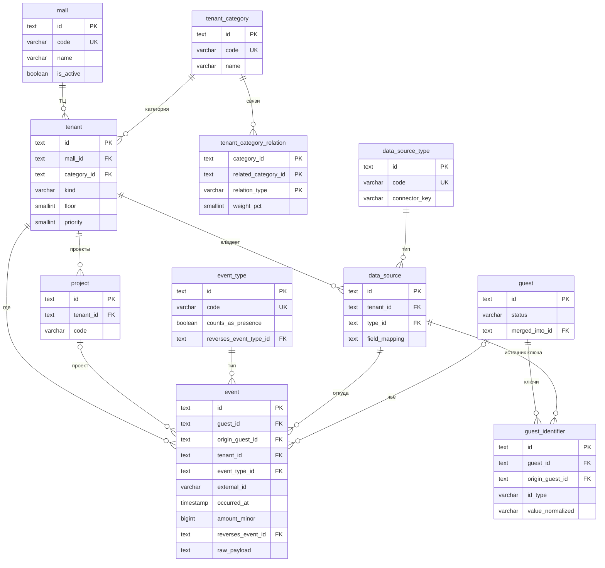
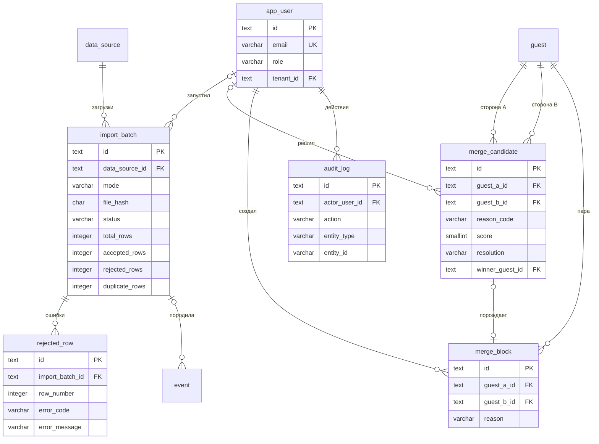
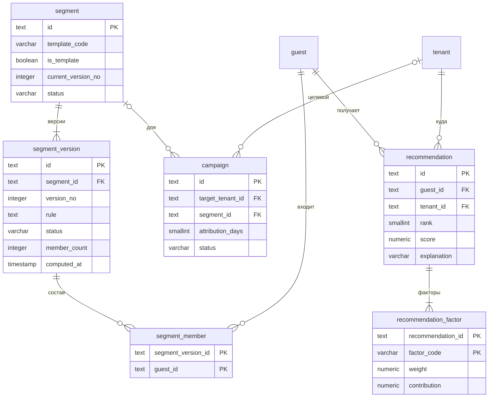
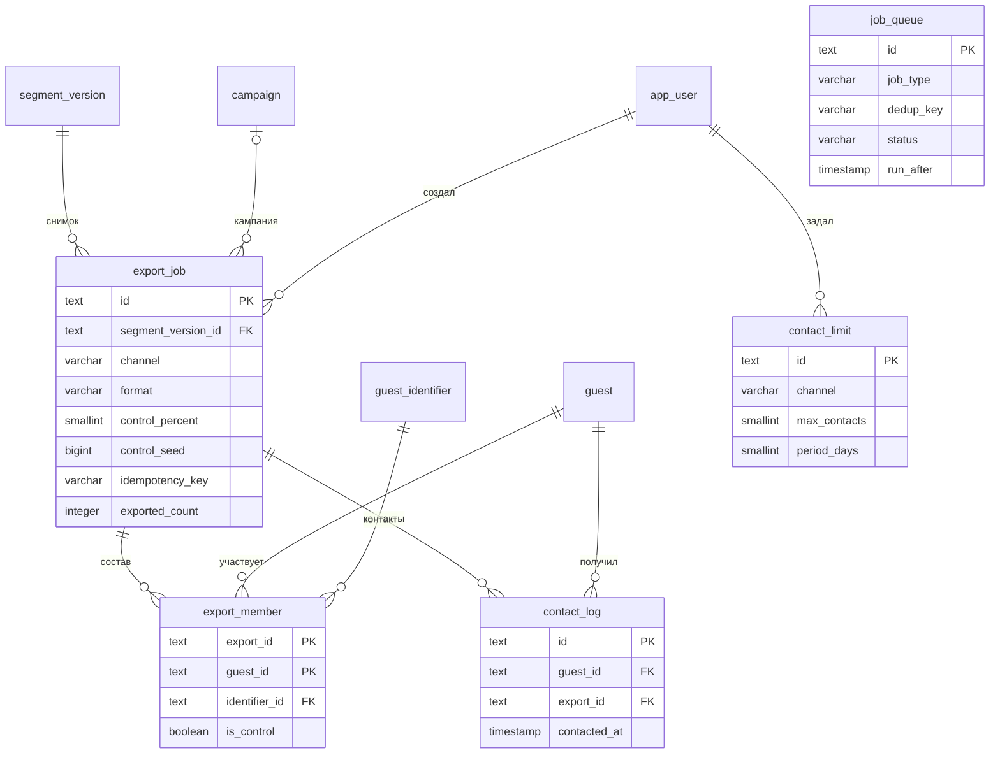

# 05. ER-модель данных, 3НФ, расширяемость, миграции

Источник схемы — миграции `apps/api/migrations/common/` (SQLite и PostgreSQL). Этот документ объясняет модель: сущности E-1…E-21 и служебная T-1 `job_queue` раскрыты в 27 таблиц базового ядра (`00001_init.sql`); политика доступа и приглашения (также в `00001_init.sql`) описаны в разделе 7. Ограничение Mermaid: `erDiagram` не умеет показывать CHECK/UNIQUE — они описаны в таблицах ниже и в миграциях. На диаграммах показаны ключевые атрибуты ядра (≤ 15 узлов на диаграмму).

## 1. Соответствие сущностей и таблиц

| Сущность                     | Таблицы                                        | Примечание                                                         |
| ---------------------------- | ---------------------------------------------- | ------------------------------------------------------------------ |
| E-1 Гость                    | `guest`                                        | `status` (`active/merged/deleted`), `merged_into_id`, `deleted_at` |
| E-2 Событие                  | `event`                                        | `guest_id` может быть NULL (не привязано)                          |
| E-3 Сегмент                  | `segment`, `segment_version`, `segment_member` | версионирование правил, материализованный состав                   |
| E-4 Арендатор                | `tenant`                                       | `mall_id` — ТЦ, `floor` — этаж внутри ТЦ                           |
| E-22 ТЦ                      | `mall`                                         | зона = пара (`mall_id`, `floor`), отдельной таблицы этажей нет     |
| E-5 Источник данных          | `data_source`, `data_source_type`              | тип — справочник                                                   |
| E-6 Категория арендатора     | `tenant_category`, `tenant_category_relation`  | смежность/конкуренция                                              |
| E-7 Проект                   | `project`                                      |                                                                    |
| E-8 Кампания                 | `campaign`                                     |                                                                    |
| E-9 Тип события              | `event_type`                                   |                                                                    |
| E-10 Идентификатор гостя     | `guest_identifier`                             |                                                                    |
| E-11 Кандидат на объединение | `merge_candidate`                              | также журнал автообъединений                                       |
| E-12 Запрет объединения      | `merge_block`                                  |                                                                    |
| E-13 Загрузка                | `import_batch`                                 |                                                                    |
| E-14 Отклонённая строка      | `rejected_row`                                 |                                                                    |
| E-15 Рекомендация            | `recommendation`, `recommendation_factor`      |                                                                    |
| E-16 Выгрузка                | `export_job`                                   | в коде `Export`                                                    |
| E-17 Член выгрузки           | `export_member`                                |                                                                    |
| E-18 Лимит контактов         | `contact_limit`                                |                                                                    |
| E-19 Контакт                 | `contact_log`                                  |                                                                    |
| E-20 Пользователь            | `app_user`                                     | `user` — зарезервированное слово PostgreSQL                        |
| E-21 Аудит                   | `audit_log`                                    |                                                                    |
| T-1 (служебная)              | `job_queue`                                    | очередь воркеров, D-8                                              |

## 2. ER-диаграммы

### 2.1. Ядро: справочники, гость, событие

Пояснение. Диаграмма показывает, что `event` — центральный факт: он связан с арендатором, типом события, источником, необязательным проектом и необязательным гостем (`guest_id` NULL, пока ключи не сопоставлены, — такие строки составляют знаменатель match rate). Справочники (`tenant_category`, `event_type`, `data_source_type`) отделены от фактов, поэтому новый тип источника или события добавляется строкой, а не изменением схемы. У `data_source.tenant_id` допускается NULL для общих источников УК (Wi-Fi, парковка; Q-3). `guest_identifier` хранит несколько ключей на гостя и не уникален глобально (A-15), а `origin_guest_id` в `guest_identifier` и `event` нужен для обратимости объединения. Связи `tenant_category_relation` дают скорингу смежность и конкурентов без отдельных таблиц под каждый тип.

### 2.2. Идентификация и импорт

Пояснение. Загрузка (`import_batch`) хранит хэш файла и счётчики с инвариантом `accepted + rejected + duplicate = total`; уникальность `(data_source_id, file_hash)` делает повторную загрузку идемпотентной, а `rejected_row` даёт построчные причины (US-1). `merge_candidate` одновременно служит очередью спорных пар, журналом автообъединений и историей решений, поэтому доля оспоренных объединений считается одним запросом. `merge_block` создаётся при разъединении и отклонении и проверяется резолвером перед каждым автослиянием. Пара хранится в каноническом порядке (`guest_a_id < guest_b_id`), чтобы исключить зеркальные дубли. Каждое решение дополнительно пишется в `audit_log` (он append-only).

### 2.3. Сегменты и рекомендации

Пояснение. Сегмент разделён на неизменяемые версии правила (`segment_version.rule` — JSON DSL), поэтому выгрузка ссылается на конкретную версию и остаётся воспроизводимой даже после правки правила. Состав материализован в `segment_member` (быстрые выгрузка и пересечения), размер кэшируется в `member_count` (допустимая контролируемая денормализация: производное значение, пересчитывается воркером). Шаблоны хранятся теми же таблицами (`is_template = TRUE`), поэтому пятый шаблон добавляется INSERT-ом. Рекомендация хранит ранг ≤ 3, оценку и снимок обоснования, а `recommendation_factor` раскладывает оценку по факторам для прозрачности; уникальность `(guest_id, tenant_id)` не даёт предложить одно место дважды.

### 2.4. Выгрузка, контакты, очередь

Пояснение. `export_job` фиксирует версию сегмента, канал, формат, процент и seed контрольной группы, а `UNIQUE (created_by, idempotency_key)` защищает от повторной выгрузки. `export_member` хранит и получателей, и контрольных (флаг `is_control`) вместе с использованным контактом, что гарантирует «только гости с контактом нужного канала». `contact_log` создаётся только для получателей и служит источником правила лимита (подсчёт за `period_days`) и конверсии (визиты в окне 14 дней после `contacted_at`). `contact_limit` независим от выгрузок. `job_queue` — служебная таблица очереди воркеров, не связана внешними ключами с бизнес-сущностями (полезная нагрузка в JSON), поэтому её можно заменить внешним брокером без изменения модели.

## 3. Обоснование 3НФ по таблицам

Критерий: атомарные значения (1НФ), отсутствие частичных зависимостей от составного ключа (2НФ), отсутствие транзитивных зависимостей неключевых атрибутов (3НФ). JSON-поля (`raw_payload`, `match_keys`, `rule`, `config`, `field_mapping`, `details`, `payload`) — намеренно непрозрачные документы: БД не нормализует их содержимое, приложение читает их целиком; по ним не строятся соединения и ограничения.

| Таблица                    | Ключ                                                          | Обоснование 3НФ / сознательные отступления                                                                                                                                                                                                                                                                  |
| -------------------------- | ------------------------------------------------------------- | ----------------------------------------------------------------------------------------------------------------------------------------------------------------------------------------------------------------------------------------------------------------------------------------------------------- |
| `tenant_category`          | `id`                                                          | Атрибуты зависят только от категории                                                                                                                                                                                                                                                                        |
| `tenant_category_relation` | (`category_id`, `related_category_id`, `relation_type`)       | Единственный неключевой атрибут `weight_pct` зависит от всего ключа                                                                                                                                                                                                                                         |
| `mall`                     | `id`, `UNIQUE(code)`                                          | Название и признак активности зависят от ТЦ; список этажей выводится из арендаторов (`DISTINCT tenant.floor`, кроме 0), отдельно не хранится                                                                                                                                                                |
| `tenant`                   | `id`                                                          | ТЦ — по FK `mall_id`; индекс (`mall_id`, `floor`) обслуживает зонные запросы. Категория — по FK, название категории не дублируется; `kind` (`mall`/`external`) отделяет арендатора комплекса от внешнего партнёра (A-22, D-38); `floor`, `x_m`, `y_m`, `priority` зависят от арендатора                     |
| `project`                  | `id`, `UNIQUE(tenant_id, code)`                               | Принадлежность арендатору по FK                                                                                                                                                                                                                                                                             |
| `event_type`               | `id`                                                          | Свойства типа (`has_amount`, `counts_as_presence`, `reverses_event_type_id`) вынесены из события. Отдельные типы `top_up` и `spend` с `counts_as_presence=false` различают пополнение и посещение (A-20, D-36)                                                                                              |
| `data_source_type`         | `id`                                                          | `connector_key` и возможности зависят от типа, а не от экземпляра                                                                                                                                                                                                                                           |
| `data_source`              | `id`                                                          | Тип по FK. `tenant_id` — владелец источника (NULL = общий источник УК)                                                                                                                                                                                                                                      |
| `app_user`                 | `id`                                                          | `tenant_id` зависит от пользователя; CHECK связывает роль и арендатора                                                                                                                                                                                                                                      |
| `audit_log`                | `id`                                                          | Один факт — одна строка; `actor_role` — снимок роли на момент действия (исторический факт, не транзитивная зависимость)                                                                                                                                                                                     |
| `guest`                    | `id`                                                          | Только собственные атрибуты и состояние слияния                                                                                                                                                                                                                                                             |
| `guest_identifier`         | `id`, `UNIQUE(guest_id, id_type, value_normalized)`           | Источник по FK; `origin_guest_id` — история, а не производная                                                                                                                                                                                                                                               |
| `import_batch`             | `id`                                                          | `tenant` не хранится — выводится через `data_source`. Счётчики строк — результат обработки (агрегаты по `event`/`rejected_row` пересчитать нельзя для дубликатов, поэтому хранятся как факт загрузки)                                                                                                       |
| `rejected_row`             | `id`, `UNIQUE(batch, row_number)`                             | Зависит от загрузки и номера строки                                                                                                                                                                                                                                                                         |
| `event`                    | `id`, `UNIQUE(source, type, external_id)`                     | Сознательное решение: `tenant_id` хранится в событии, а не выводится из `data_source`, потому что один источник (касса УК, общий источник) может содержать события нескольких арендаторов — зависимость не транзитивная. `origin_guest_id` — история слияния. `amount_minor`, `currency` зависят от события |
| `merge_candidate`          | `id`, `UNIQUE(a, b)`                                          | Каждая пара — одна строка; победитель/проигравший — факт решения                                                                                                                                                                                                                                            |
| `merge_block`              | `id`, `UNIQUE(a, b)`                                          | Отдельный от кандидата факт: запрет может жить после снятия кандидата                                                                                                                                                                                                                                       |
| `segment`                  | `id`                                                          | Заголовок: имя, шаблон, статус                                                                                                                                                                                                                                                                              |
| `segment_version`          | `id`, `UNIQUE(segment_id, version_no)`                        | Правило привязано к версии. `member_count` и `computed_at` — кэш производного значения (контролируемая денормализация; источник истины — `segment_member`)                                                                                                                                                  |
| `segment_member`           | (`segment_version_id`, `guest_id`)                            | Чистая связь M:N без атрибутов, кроме `added_at`                                                                                                                                                                                                                                                            |
| `campaign`                 | `id`                                                          | Цель и окно атрибуции — атрибуты кампании                                                                                                                                                                                                                                                                   |
| `recommendation`           | `id`, `UNIQUE(guest_id, rank)`, `UNIQUE(guest_id, tenant_id)` | `explanation` — снимок текста на момент расчёта (иначе обоснование изменилось бы задним числом)                                                                                                                                                                                                             |
| `recommendation_factor`    | (`recommendation_id`, `factor_code`)                          | Значения фактора зависят от пары ключа                                                                                                                                                                                                                                                                      |
| `export_job`               | `id`                                                          | Версия сегмента фиксируется; `segment_id` оставлен для запросов журнала и выводим из `segment_version`, но включён намеренно (индекс журнала по сегменту; согласован CHECK-ом на уровне service). Счётчики — итог построения                                                                                |
| `export_member`            | (`export_id`, `guest_id`)                                     | `is_control` и контакт зависят от пары                                                                                                                                                                                                                                                                      |
| `contact_limit`            | `id`                                                          | Независимое правило                                                                                                                                                                                                                                                                                         |
| `contact_log`              | `id`, `UNIQUE(export_id, guest_id)`                           | Канал не дублируется — выводится из `export_job`                                                                                                                                                                                                                                                            |
| `job_queue`                | `id`                                                          | Техническая таблица                                                                                                                                                                                                                                                                                         |

Допустимые отступления от 3НФ (все с источником истины): `segment_version.member_count`, `export_job.segment_id`, счётчики `export_job` и `import_batch`, `event.tenant_id`.

## 4. Расширяемость без изменения структуры

| Изменение требований                                  | Что делаем                                                                                                                                                                                 | Что НЕ меняется                                 |
| ----------------------------------------------------- | ------------------------------------------------------------------------------------------------------------------------------------------------------------------------------------------ | ----------------------------------------------- |
| Новый тип источника (например, iiko, 1С)              | `INSERT data_source_type (code, connector_key, supports_*, config_schema)`; новая реализация `SourceConnector` в `internal/ingestion/connectors`; `INSERT data_source` с `field_mapping`   | Схема БД, `event`, API                          |
| Новый тип события (например, «парковка», «абонемент») | `INSERT event_type (code='parking', has_amount=false, counts_as_presence=true)`; в маппинге источника — соответствие значений. Так же добавлены `top_up`, `spend`, `reversal` (A-20, D-36) | Схема, сегменты, скоринг                        |
| Новая категория или связь смежности/конкуренции       | `INSERT tenant_category`, `tenant_category_relation`                                                                                                                                       | Код скоринга (читает связи)                     |
| Новый шаблон сегмента                                 | `INSERT segment (is_template=TRUE, template_code=…)` + `segment_version` с JSON-правилом                                                                                                   | Схема; вычислитель читает DSL                   |
| Новое условие правила (например, «сумма > X»)         | Новый оператор в DSL `rule` и в `SegmentEvaluator` (регистрация оператора)                                                                                                                 | Схема, версии старых правил (хранят старый DSL) |
| Новый атрибут строки источника                        | Остаётся в `event.raw_payload`; при необходимости — отображение в маппинге                                                                                                                 | Схема                                           |
| Новый тип идентификатора (Wi-Fi MAC, номер авто)      | Регистрация типа в `identity` (нормализатор + признак «надёжный»); `id_type` без CHECK                                                                                                     | Схема (`guest_identifier` хранит строкой)       |
| Новый канал выгрузки (WhatsApp)                       | Реализация `ExportChannel`; значение добавляется в CHECK `export_job.channel`/`contact_limit.channel` (миграция одной строкой)                                                             | Остальное (D-11)                                |
| Версионирование правил                                | Каждая правка — новая `segment_version`; выгрузки ссылаются на версию                                                                                                                      | Старые выгрузки                                 |
| Soft-delete гостя и обратимость объединения           | `guest.status/deleted_at/merged_into_id`, `origin_guest_id` в `event` и `guest_identifier`, `merge_candidate.resolution`                                                                   | Физически данные не удаляются                   |

Обратимость объединения. Слияние A в B: A получает `status='merged'`, `merged_into_id=B`; `event.guest_id` и `guest_identifier.guest_id` строк с `origin_guest_id=A` переписываются на B; `merge_candidate` получает `winner/merged_guest_id` и `resolution`. Разъединение возвращает строки с `origin_guest_id=A` обратно на A, ставит `A.status='active'`, `resolution='reverted'` и создаёт `merge_block`. События, поступившие после слияния, получают `origin_guest_id` текущего профиля; при revert они остаются у победителя, если их ключи принадлежат ему (правило фиксируется в D-5).

## 5. Отличия SQLite и PostgreSQL

Статус: проектная цель — переносимость; текущая реализация (`sqlstore`, goose) работает только с PostgreSQL, поддержка SQLite не реализована.

| Аспект                       | SQLite (старт)                                                      | PostgreSQL (цель)                  | Как нейтрализуем                                                                                          |
| ---------------------------- | ------------------------------------------------------------------- | ---------------------------------- | --------------------------------------------------------------------------------------------------------- |
| Идентификаторы               | `TEXT`                                                              | `TEXT` (допустим `UUID` миграцией) | UUIDv7 из приложения (D-1)                                                                                |
| Время                        | `TIMESTAMP` хранится как текст ISO-8601                             | `TIMESTAMP` → `TIMESTAMPTZ`        | Всегда UTC, миграция `ALTER ... TYPE TIMESTAMPTZ USING ... AT TIME ZONE 'UTC'`                            |
| JSON                         | `TEXT` (функции `json_*`, нет индексов по полям)                    | `JSONB` + GIN                      | Отдельная PG-миграция; приложение не использует JSON-функции БД в общем коде (D-3)                        |
| Булевы                       | `BOOLEAN` = 0/1                                                     | `BOOLEAN`                          | Драйверы Go обрабатывают оба                                                                              |
| Деньги                       | `BIGINT`                                                            | `BIGINT`                           | Минорные единицы (D-2); `NUMERIC` не нужен                                                                |
| `NUMERIC(p,s)` (score, веса) | Аффинность NUMERIC (float)                                          | Точный `NUMERIC`                   | Допустимо: оценки не денежные; в Go — `float64`                                                           |
| Частичные индексы            | Поддерживаются                                                      | Поддерживаются                     | Без различий                                                                                              |
| Внешние ключи                | Требуют `PRAGMA foreign_keys=ON` на каждое соединение               | Всегда включены                    | Установка pragma в открывающем коде пула                                                                  |
| ALTER TABLE                  | Ограничен (нет `ADD CONSTRAINT`, смена типа — пересоздание таблицы) | Полный                             | Миграции только `CREATE`/`ADD COLUMN`/индексы; типы PG меняются в PG-ветке                                |
| Конкурентная запись          | Один писатель; WAL; `busy_timeout`                                  | MVCC, много писателей              | Единый пул записи (≤ 1 писателя для SQLite), короткие транзакции, батчи по 500–1000 строк                 |
| Блокировка заданий очереди   | Нет `SELECT ... FOR UPDATE SKIP LOCKED`                             | Есть                               | `Queue.Claim` — интерфейс: SQLite-реализация `UPDATE … WHERE id=(SELECT …) RETURNING`; PG — `SKIP LOCKED` |
| Upsert                       | `INSERT … ON CONFLICT DO NOTHING/UPDATE` (3.24+)                    | то же                              | Один синтаксис, идемпотентный приём событий                                                               |
| Регистр/сортировка           | `LIKE` регистронезависим для ASCII; `COLLATE NOCASE`                | регистрозависим                    | Ключи нормализуются в приложении (lowercase), поиск по имени — через `lower()`                            |
| Автоинкремент                | не используется                                                     | не используется                    | Нет `SERIAL`/`AUTOINCREMENT`                                                                              |
| Размер/объём                 | до ~10–50 ГБ комфортно                                              | практически без ограничений        | A-7: ~1–3 млн событий/год, SQLite достаточно на пилот                                                     |

## 6. Миграции

Инструмент — goose; файлы `NNNNN_name.sql` с блоками `-- +goose Up` и `-- +goose Down`.

| Файл                    | Содержимое                                                                                                                                                                                                                                               |
| ----------------------- | -------------------------------------------------------------------------------------------------------------------------------------------------------------------------------------------------------------------------------------------------------- |
| `common/00001_init.sql` | 27 таблиц ядра: справочники, пользователи и аудит, гости, импорт, события, объединение, сегменты, кампании, рекомендации, выгрузки, контакты, `job_queue`; каталог разрешений, права ролей и гранты, приглашения; seed справочников и шаблонов сегментов |

Правила: применённая миграция не правится, изменения — новой миграцией; в `common/` только переносимый SQL (без ENUM, триггеров, массивов, `SERIAL`), смена типов под PostgreSQL (`TIMESTAMPTZ`, `JSONB`, партиционирование `event`) — отдельными файлами в `postgres/`; seed идемпотентен; новый канал выгрузки — миграция CHECK у `export_job.channel` и `contact_limit.channel` (D-11); новый тип источника или события — только seed-запись. Переход SQLite → PostgreSQL: остановка воркеров, выгрузка таблиц в порядке миграций, применение `postgres/`; обратный путь не поддерживается. Очистка: `job_queue` со статусом `done` — 7 дней, файлы загрузок — 30 дней (Q-25).

## 7. Политика доступа и приглашения

Права ролей хранятся в БД (D-10 пересмотрено): код проверяет разрешения, а не роли напрямую.

| Таблица               | Назначение                                                                                                                               |
| --------------------- | ---------------------------------------------------------------------------------------------------------------------------------------- |
| `permission`          | Каталог разрешений: `action` (операция), `metric` (показатель с порогом `min_k`), `field` (поле ответа); признак `is_sensitive`          |
| `role_permission`     | Потолок роли: максимум разрешений, который роль вообще может получить                                                                    |
| `access_policy_state` | Версия политики; растёт при каждом изменении, попадает в приглашения и аудит                                                             |
| `access_grant`        | Грант субъекту (`user`, `tenant` или `role`): статус `draft`, `active`, `suspended`, `revoked`, `expired`; срок или бессрочный           |
| `access_grant_item`   | Разрешение в гранте: `allow` или `deny`                                                                                                  |
| `access_grant_scope`  | Ограничения гранта: `tenant`, `category`, `channel`, `metric`, `period_days`, `field_mask`, `k_threshold`, `row_limit`, `principal_role` |
| `user_invitation`     | Приглашение (`invite`) или восстановление (`recovery`) для ролей `manager` и `tenant`; токен хранится хэшем, одноразовый, со сроком      |

Решение принимает `access.Decide`: разрешение должно входить в потолок роли; для R-3 обязателен грант с областью `tenant`, совпадающей с его арендатором; `deny` в подходящем гранте запрещает операцию; пределы (`period_days`, `row_limit`, `k_threshold` по умолчанию 5, `field_mask`) берутся из подходящих грантов. REST-операции — `endpoint-registry.md`, раздел 12; код — `apps/api/internal/access`.
