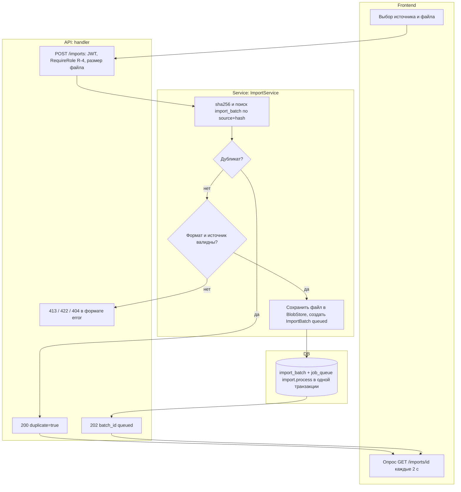
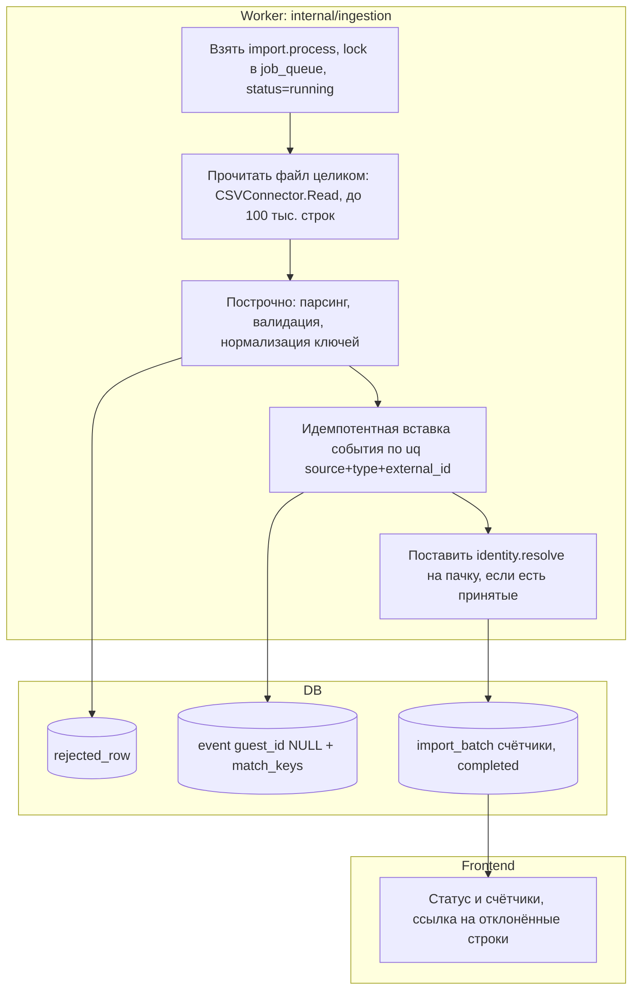
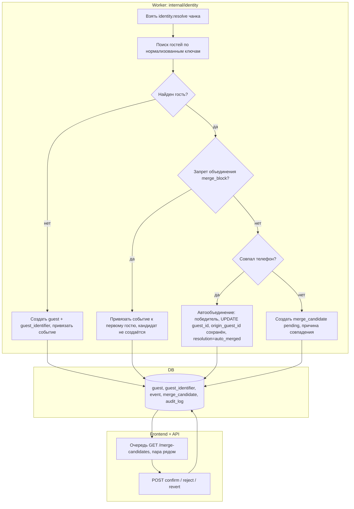
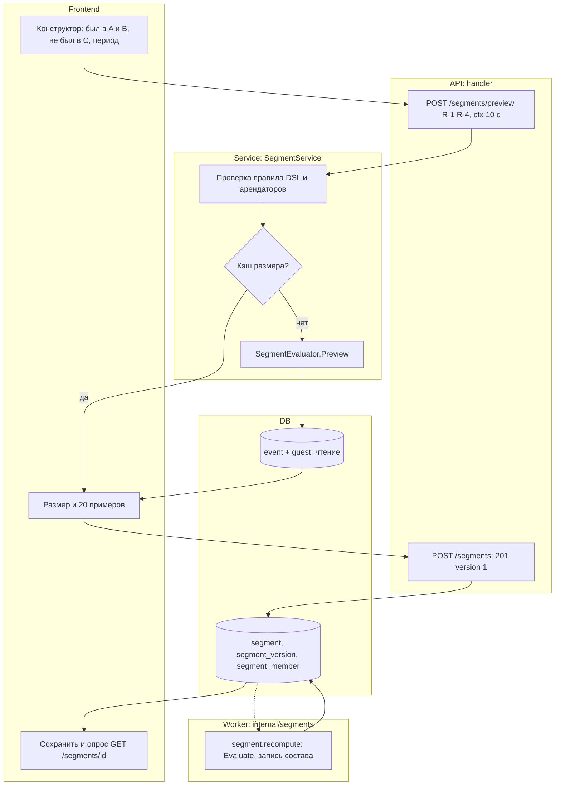
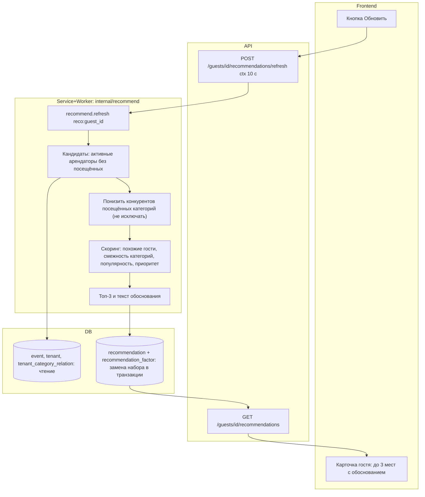
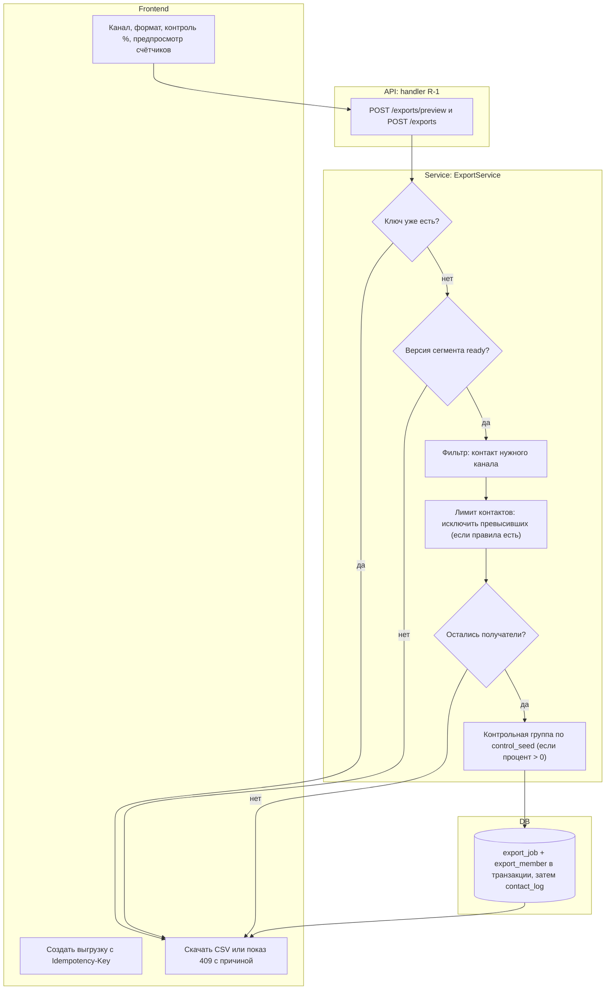

# 08. Activity Diagrams (swimlanes)

Mermaid не имеет нативных swimlanes: используется `flowchart TB`, дорожки — `subgraph` (Frontend / API / Service / Worker / DB), fork/join — тонкие узлы-«шины» `FORK`/`JOIN`, ромбы — решения. Ограничение: порядок дорожек на рендере определяет движок, поэтому направление стрелок важнее расположения. Каждая диаграмма ≤ ~15 узлов; импорт разбит на AD-1a (приём) и AD-1b (обработка). Всё опирается на `endpoint-registry.md` (эндпоинты, задания очереди) и `apps/api/migrations/common/` (таблицы). Изоляция R-3: ни в одном из потоков R-3 не участвует, кроме собственных агрегатов (UC-8); `tenant_id` из JWT проверяется в `service` и подставляется фильтром в `repository` (см. 07 §3).

Общие обозначения: `ctx` — `context.Context` с дедлайном и `request_id`; все запросы к БД и вызовы воркеров принимают `ctx`.

## AD-1a. Импорт файла: приём (UC-1, US-1)

Пояснение. Приём файла синхронный и короткий: хэш считается потоково, дубликат (тот же `file_hash` для того же `data_source_id`, уникальный индекс `UNIQUE(data_source_id, file_hash)`) возвращает 200 с существующей загрузкой и `duplicate=true` (D-9), новых событий не создаётся. Для нового файла файл сохраняется в `BlobStore` (D-28), а запись `import_batch` и задание `import.process` с `dedup_key=import:{batch_id}` пишутся в одной транзакции, чтобы не потерять задание при сбое. Ответ 202 возвращается сразу; интерфейс опрашивает статус. Ошибки: 413 `file_too_large` (>100 тыс. строк или >лимита размера), 422 `bad_format` (неверный формат, пустой файл, деактивированный источник или источник без поддержки файлов, неверный маппинг), 404 (источник не найден), 403 для чужой роли. Для R-3 эндпоинт закрыт.

## AD-1b. Импорт файла: обработка воркером (UC-1, UC-6, UC-12)

Пояснение. Воркер читает файл целиком (`CSVConnector.Read`, XLSX предварительно приводится к CSV), затем `ingestion.Pipeline.ProcessRows` обрабатывает строки последовательно в одной горутине: валидация (даты, сумма, `external_id`, ключи) и нормализация ключей (`identity/normalize`: телефон E.164, email в нижнем регистре). Ошибочные строки накапливаются с номером и кодом и пишутся в `rejected_row` пачками по 200 и в конце. Каждое событие вставляется отдельно с игнорированием конфликта по `UNIQUE(data_source_id, event_type_id, external_id)`: конфликт считается как `duplicate`, так что `accepted + rejected + duplicate = total`. События сохраняются с `guest_id=NULL` и `match_keys`; привязку выполняет задание `identity.resolve` (AD-2) с `dedup_key=resolve:{batch_id}`, которое ставится один раз на пачку, если есть принятые строки; после него воркер ставит пересчёты сегментов и рекомендаций (UC-6, AD-3, AD-4). Задание принимает `ctx`; при рестарте оно возвращается в очередь и безопасно повторяется благодаря идемпотентности вставки, а уже завершённая пачка повторно не обрабатывается. Статус `completed_with_errors` ставится, если `rejected > 0`.

## AD-2. Автообъединение и спорное объединение (UC-12, UC-11, US-11)

Пояснение. Для каждого события воркер ищет гостей по надёжным ключам (телефон, email, карта). Если гостей нет, создаётся новый; совпадение с одним гостем просто привязывает событие. Если ключи события принадлежат двум разным гостям, проверяется запрет объединения (E-12): пара под запретом остаётся раздельной, кандидат не создаётся, а событие привязывается к первому найденному гостю. Без запрета решает тип совпавшего ключа: общий телефон даёт автообъединение (`score` 90, `shared_phone`) в одной транзакции — события и идентификаторы переходят победителю, `origin_guest_id` хранит прежнего владельца (D-5), проигравший получает `status=merged` и `merged_into_id`, пишутся `merge_candidate` с `auto_merged` и запись аудита; общий email (`score` 70, `shared_email`), общая карта (`score` 75, `shared_card`) и конфликт без общего ключа (`score` 50, `multi_key_conflict`) создают `merge_candidate` со статусом `pending`, который ждёт R-4 (Q-12). Confirm выполняет то же объединение, reject создаёт запрет, revert возвращает события по `origin_guest_id` и тоже создаёт запрет (SD-6). Сравнение имён в сопоставлении не участвует.

## AD-3. Построение сегмента с предпросмотром (UC-3, UC-13, US-3)

Пояснение. Каждое изменение условий вызывает предпросмотр с дебаунсом: `service` проверяет правило (DSL с полями `visitedTenantIds`, `excludedTenantIds`, `periodDays`, `requireContact`), смотрит кэш размера по хэшу правила и при промахе вызывает `SegmentEvaluator.Preview`, который считает размер и 20 примеров прямо по `event` без записи. Ограничение времени 10 с задаётся через `context.WithTimeout`; при превышении клиент получает 504 и подсказку сузить правило. Сохранение создаёт `segment_version` №1 со статусом `pending` и ставит `segment.recompute` (`segment:{id}:{version_no}`) — ответ 201 приходит сразу. Воркер вычисляет состав и записывает `segment_member`, `member_count`, `computed_at`, после чего статус `ready`; интерфейс опросом видит готовность. Правка правила создаёт новую версию, старая неизменяема (D-7). Предустановленные шаблоны («Спящий сосед» и др.) — те же правила с `template_code`.

## AD-4. Формирование рекомендации (UC-15, UC-4, UC-6, US-4)

Пояснение. Пересчёт запускается автоматически после изменения ленты гостя (UC-6, задание `recommend.refresh` с `dedup_key reco:{guest_id}` схлопывает лишние запуски) или вручную кнопкой (синхронный вызов `Recommender.Refresh` с таймаутом 10 с, иначе 504). Кандидаты — активные арендаторы, где гость ещё не был, поэтому посещённые места не попадают в выдачу. Прямые конкуренты категорий посещённых мест **не исключаются**, а получают понижающий коэффициент: заказчик прямо указал, что внутри комплекса запрета на рекомендацию конкурента нет (FAQ В-7, A-18, D-34); жёсткое исключение остаётся опцией категории. Остальные кандидаты получают взвешенную сумму факторов (веса из конфигурации, версия алгоритма пишется в `recommendation.algorithm_version`, D-15). Если у гостя нет событий, срабатывает fallback по популярности и приоритету арендатора с пометкой «мало данных» (A-21, D-37). Остаются три лучших; для каждой сохраняется текст обоснования и разложение по факторам (`recommendation_factor`). Набор заменяется транзакцией, чтобы чтение никогда не видело неполный набор. Чтение через `GET` быстрое и не пересчитывает (D-12).

## AD-5. Выгрузка сегмента с лимитом контактов и контрольной группой (UC-5, UC-10, US-5, US-10)

Пояснение. Предпросмотр возвращает четыре числа: в сегменте, с контактом канала, заблокировано лимитом, в контрольной группе. Создание требует заголовок `Idempotency-Key`: повтор с тем же ключом возвращает ту же выгрузку, а не создаёт новую. Если версия сегмента не `ready`, возвращается 409. Дальше исключаются гости без идентификатора нужного канала (`sms` и `push` — телефон, `email` — email, Q-21). Лимит контактов применяется только при наличии правил `contact_limit`: заказчик не задаёт жёсткий лимит частоты (FAQ В-9, A-12), поэтому при пустой таблице шаг S4 пропускается. Если правила есть, исключаются гости, превысившие самое строгое из них (общее и по каналу, Q-13); если не осталось ни одного получателя, ответ 409 с разбивкой причин. Контрольная группа опциональна: при `control_percent = 0` шаг S6 пропускается, иначе группа выбирается детерминированно по `control_seed` (D-17) и не попадает в CSV и в `contact_log` (A-19). Записи `export_job` и `export_member` идут одной транзакцией, затем отдельной вставкой пишется `contact_log` для получателей; повторной проверки лимита внутри транзакции и записи в `audit_log` в коде нет (расхождение с D-26). Выгрузка всегда строится синхронно в рамках запроса (201), дедлайн запроса задан Q-23; асинхронная сборка вне объёма MVP.
