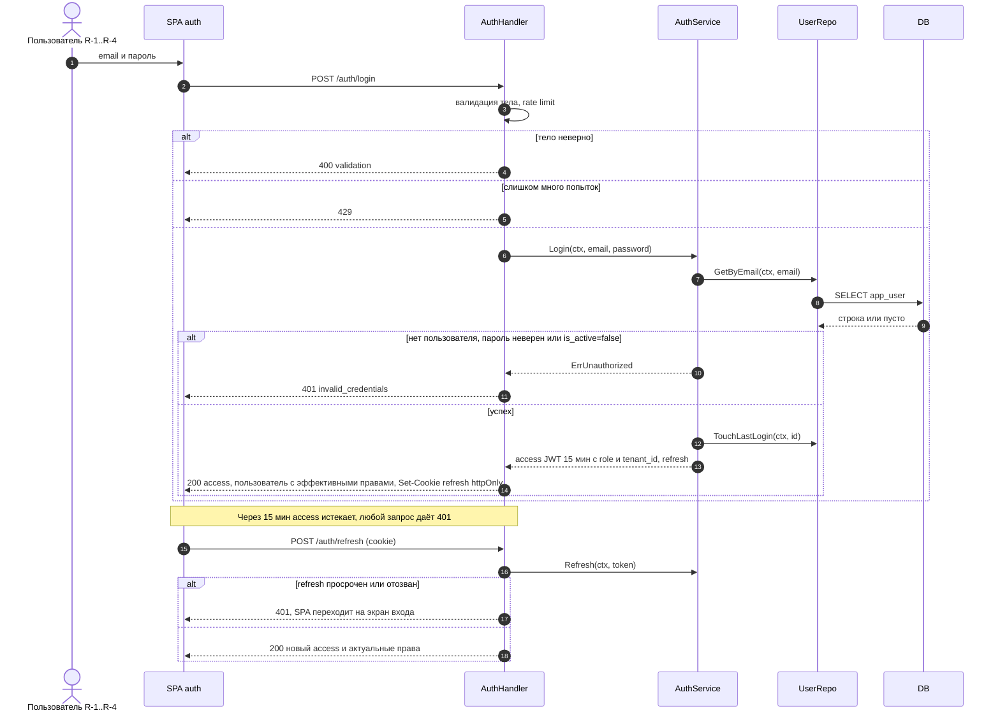
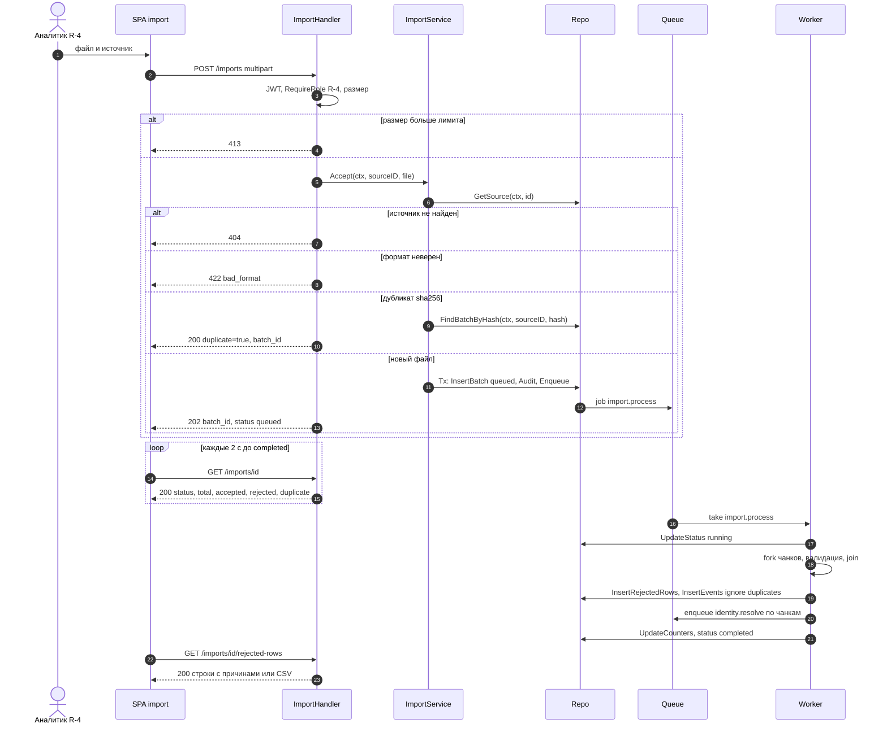
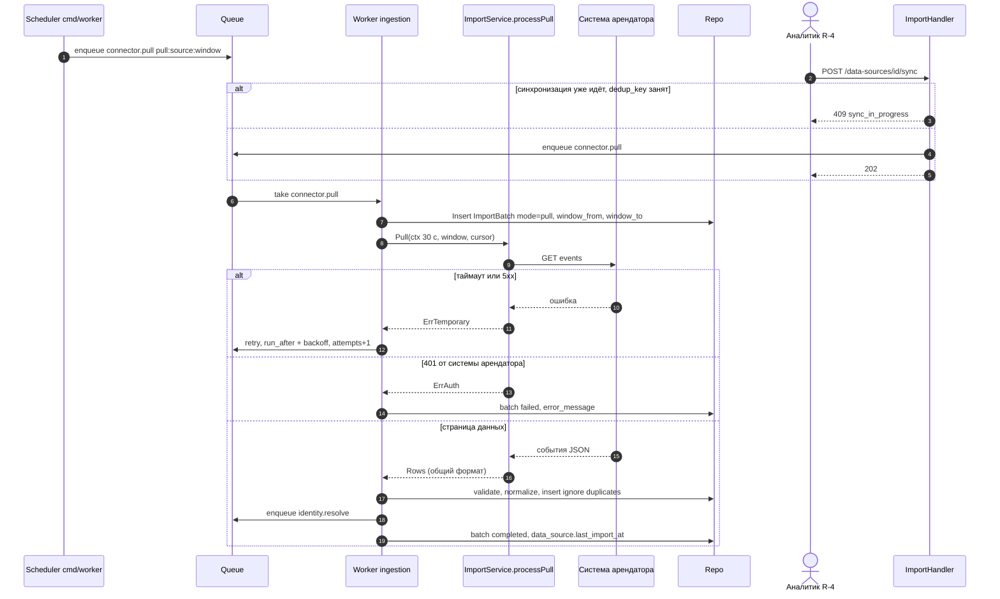
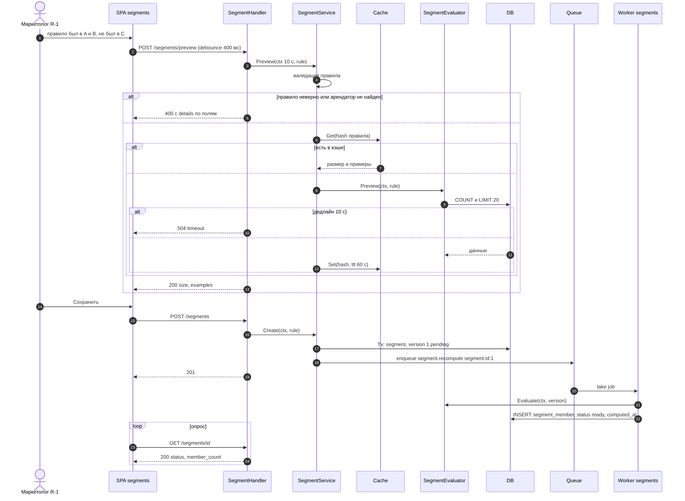
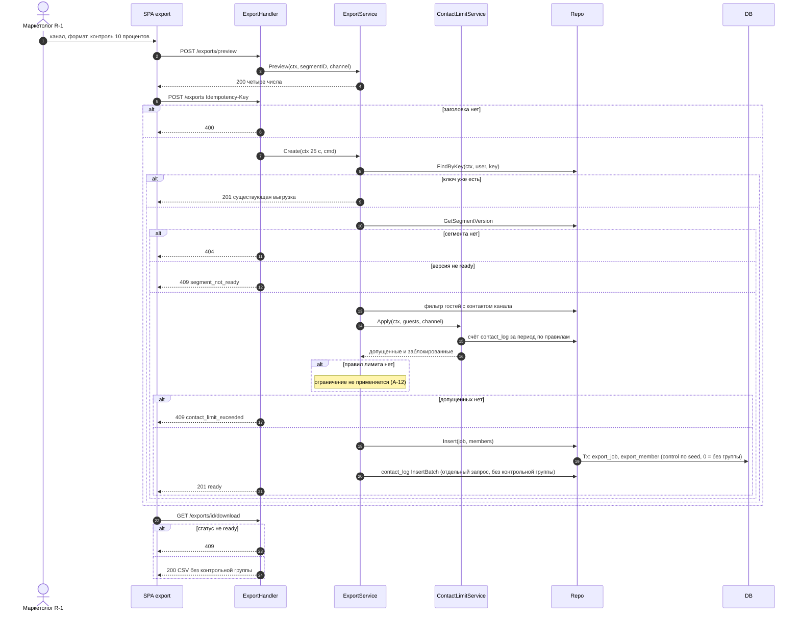
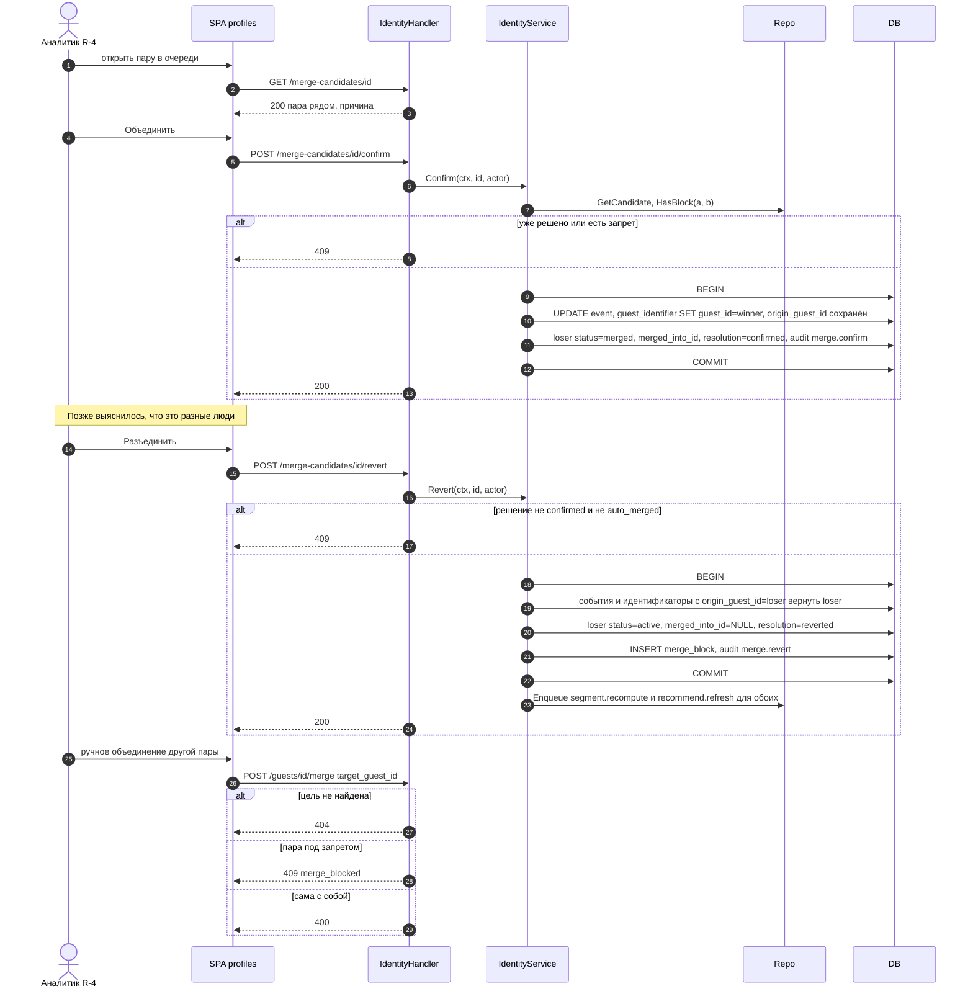
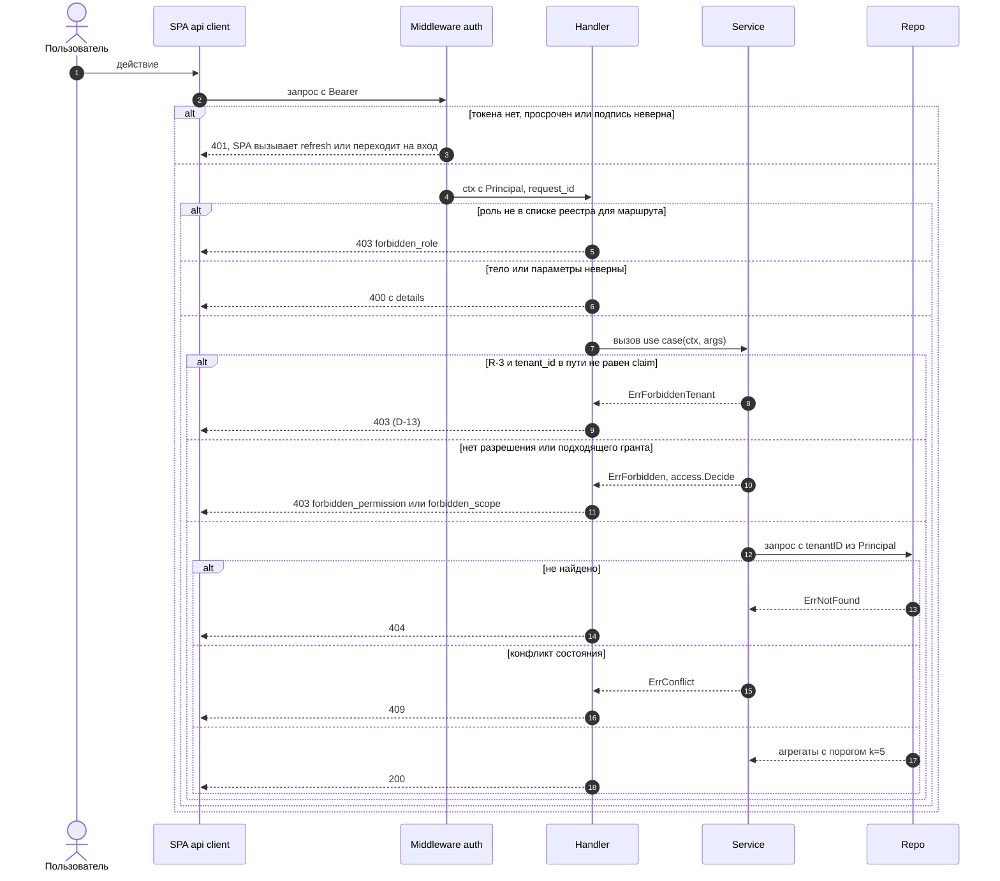
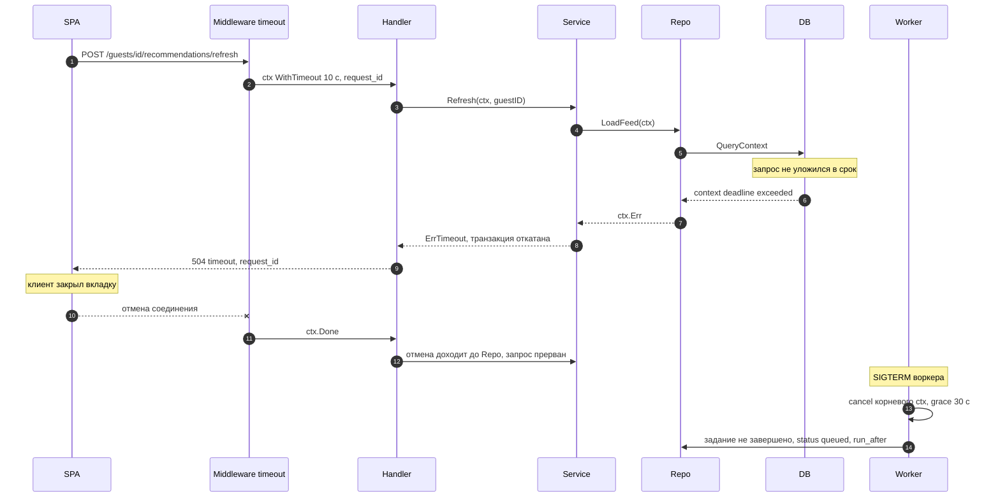
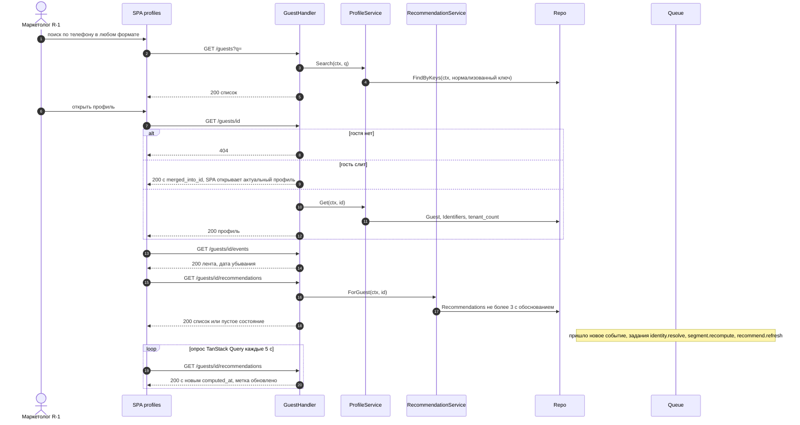

# 09. Sequence Diagrams

Mermaid `sequenceDiagram`. Участники используют единые имена: `SPA` (React), `Handler` (`internal/handler`), `Service` (`internal/service`), `Repo` (`internal/repository`), `DB`, `Queue` (`job_queue`, `platform/queue`), `Worker` (`cmd/worker`). Во всех запросах: заголовок `Authorization: Bearer <JWT>`; middleware кладёт `Principal{user_id, role, tenant_id}` и `request_id` в `context.Context`; ошибки имеют единый формат `{"error":{code,message,details,request_id}}` (реестр, шапка). Ограничение Mermaid: в тексте сообщений нельзя использовать точку с запятой, поэтому сложные условия записаны через запятую. Бюджет таймаутов (Q-23): запрос по умолчанию 30 с, предпросмотр сегмента 10 с, синхронная выгрузка 25 с, внешний HTTP коннектора 30 с, задание воркера 15 мин; превышение даёт 504 с кодом `timeout`.

## SD-1. Вход в систему (UC-16)

Пояснение. Логин сверяет хэш пароля и активность учётной записи; одинаковый 401 на неверный email и неверный пароль не раскрывает существование пользователя. В `access` кладутся `role` и, для R-3, `tenant_id` — это единственный источник арендатора для всех последующих проверок. `refresh` хранится в httpOnly-cookie и обновляется эндпоинтом `/auth/refresh`; при 401 SPA один раз пытается обновить токен (single-flight, D-29), затем отправляет на вход. Все обращения к БД принимают `ctx`.

## SD-2. Загрузка файла: async 202, статус и построчные ошибки (UC-1, UC-6)

Пояснение. Клиент получает 202 сразу и далее только читает статус: тело запроса не ждёт обработки (UC-1, US-1). Повторная загрузка того же файла даёт 200 с `duplicate=true` и существующим `batch_id` (D-9); дублей событий нет также на уровне уникального индекса события, поэтому даже изменённый файл с частично теми же строками не создаёт дублей. Построчные ошибки (`invalid_date`, `no_external_id`, `invalid_amount`) попадают в `rejected_row`, их можно скачать CSV. Задание `import.process` безопасно перезапускается (`dedup_key import:{batch_id}`).

## SD-3. API-коннектор подтягивает события (UC-14)

Пояснение. Pull запускается по расписанию (раз в час, Q-10) или вручную; ручной вызов возвращает 409, если для того же окна уже есть активное задание (уникальный `dedup_key`). `ImportService.processPull` запрашивает `config.url` источника (HTTP GET, ответ — CSV) и приводит его к общему виду строк, после чего конвейер валидации и вставки тот же, что у файлов (AD-1b), поэтому идемпотентность и счётчики идентичны. Сетевые сбои повторяются с экспоненциальной паузой до N попыток, постоянные ошибки (неверные учётные данные источника) переводят загрузку в `failed` и отражаются в качестве источников (UC-9). Внешний вызов имеет собственный `ctx` с таймаутом 30 с, наследующий отмену задания.

## SD-4. Сегмент с предпросмотром размера (UC-3, UC-13)

Пояснение. Предпросмотр не пишет в БД и защищён кэшем и дедлайном 10 с; ответ 400 содержит поля с ошибками правила, 504 — подсказку сузить период (D-6). Сохранение быстрое (201), пересчёт состава выполняет воркер; пока статус `pending` или `computing`, выгрузка из сегмента вернёт 409 (SD-5). Правка через `PUT /segments/{id}` повторяет ту же схему с `version_no+1`. Новое событие (UC-6) ставит `segment.recompute` для сегментов, затронутых гостем, и обновляет `computed_at`.

## SD-5. Выгрузка сегмента: лимит контактов и 409 (UC-5, UC-10)

Пояснение. Предпросмотр показывает, сколько гостей будет исключено лимитом, до создания записи. Повтор `POST /exports` с тем же `Idempotency-Key` не создаёт вторую выгрузку и не дублирует контакты. Лимит применяется только при наличии правил: заказчик не задаёт жёсткий лимит частоты (FAQ В-9, A-12), поэтому при пустой таблице `contact_limit` выгрузка проходит без ограничения. Если правила есть, лимит проверяется один раз, при отборе получателей (`blockedForChannel`), до записи; повторной проверки внутри транзакции нет, поэтому две параллельные выгрузки с разными ключами теоретически могут обойти лимит (D-26 в коде не реализован). `export_job` и `export_member` пишутся одной транзакцией `ExportSQL.Insert` (уровень изоляции по умолчанию, без `BEGIN IMMEDIATE`), `contact_log` добавляется следующим отдельным запросом, запись в `audit_log` при выгрузке не делается. Повторный запрос с тем же ключом возвращает существующую выгрузку, а `UNIQUE (created_by, idempotency_key)` в БД защищает от дубля при гонке. Если ни один гость с контактом не прошёл лимит, возвращается 409 `contact_limit_exceeded`. Контрольная группа опциональна: при `control_percent = 0` она не выделяется, иначе детерминирована по `control_seed` (D-17) и не пишется в `contact_log` (A-19). CSV содержит только не-контрольных получателей; API-выгрузка для провайдера — `GET /exports/{id}/members`.

## SD-6. Ручное объединение и разъединение профилей (UC-11)

Пояснение. Объединение и разъединение — одна транзакция, поэтому профиль никогда не бывает наполовину слитым. Обратимость основана на `origin_guest_id` в `event` и `guest_identifier` (D-5), включая автообъединения (`auto_merged`). Revert и reject создают запись в `merge_block`, после чего автообъединение эту пару не повторит; снять запрет может только R-4 (`DELETE /merge-blocks/{id}`). После изменения состава профилей ставятся пересчёты сегментов и рекомендаций обоих гостей. Любое действие пишет `audit_log` с `request_id`. R-1 видит очередь только на чтение, при `confirm` получит 403.

## SD-7. Сквозная цепочка ошибок 400 / 401 / 403 / 404 / 409 и изоляция R-3

Пояснение. Проверки идут в фиксированном порядке: аутентификация (401), роль по реестру (403), валидация (400), бизнес-правила (403 для чужого арендатора, 404, 409). Изоляция R-3 двойная: `service` сравнивает `tenant_id` из пути с claim и возвращает 403 (D-13), а `access.Decide` отклоняет запрос с `forbidden_tenant`, если `Resource.TenantID` не совпадает с `Principal.TenantID`. Данные арендатора читают репозитории, принимающие `tenantID` параметром и подставляющие его в SQL-фильтр `tenant_id` (например, `TenantGuestSQL` фильтрует события по `e.tenant_id`); сервис передаёт туда `principal.TenantID`, а не значение из запроса. R-3 допущен к `GET /tenants`, `GET /tenants/{id}`, `GET /tenants/{id}/aggregates`, `GET /auth/me`, а к чтению гостей и событий — только по гранту, выданному R-2 (`access.Decide`); ячейки меньше k=5 скрываются (Q-18). Frontend прячет недоступные пункты меню, но решающая проверка всегда на backend. Коды ошибок и тело — единый формат реестра.

## SD-8. Таймауты и распространение context.Context

Пояснение. Каждый входящий запрос получает собственный `ctx` с дедлайном (30 с по умолчанию, 10 с для предпросмотра и принудительного пересчёта, 25 с для синхронной выгрузки); `ctx` первым аргументом проходит через `handler → service → repository` до `QueryContext`/`ExecContext`, поэтому отмена клиента и истечение срока прерывают запросы и откатывают транзакции. Таймаут превращается в 504 `timeout`, обрыв клиента не порождает ответа. Воркер на SIGTERM отменяет корневой `ctx`, доводит текущую транзакцию в пределах grace-периода и возвращает недоделанное задание в очередь; повтор безопасен благодаря идемпотентности (`dedup_key`, уникальный индекс события). Внешние вызовы коннектора имеют вложенный `ctx` 30 с.

## SD-9. Профиль гостя, рекомендации и видимое обновление (UC-2, UC-4, UC-6)

Пояснение. Поиск нормализует введённое значение теми же правилами, что и при импорте, поэтому `+7 900…` и `8900…` находят одного гостя. Для слитого профиля ответ несёт `merged_into_id`, и интерфейс переходит на актуальный профиль; для несуществующего возвращается 404, для R-3 маршруты `/guests*` открыты только по гранту и только по данным собственного арендатора, иначе 403. Профиль, лента и рекомендации читаются отдельными быстрыми запросами; чтение рекомендаций не пересчитывает их (D-12). После нового события фоновые задания обновляют ленту, сегменты и рекомендации, а интерфейс видит изменение при опросе с интервалом 5 с (D-22), без ручного запуска (UC-6).
