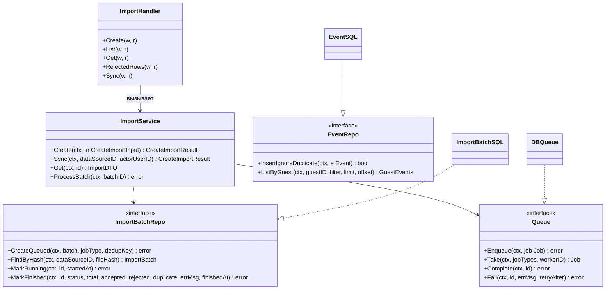
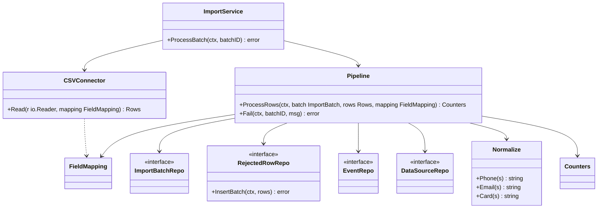
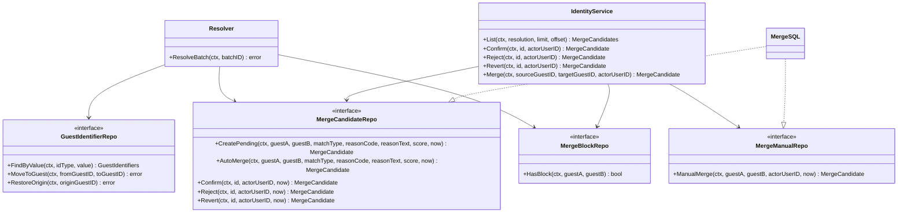
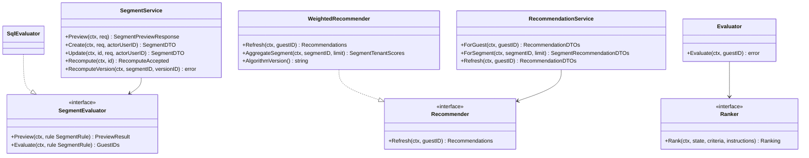
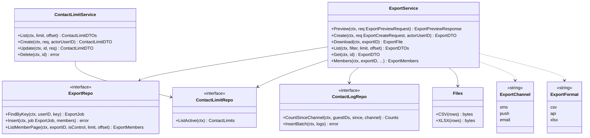
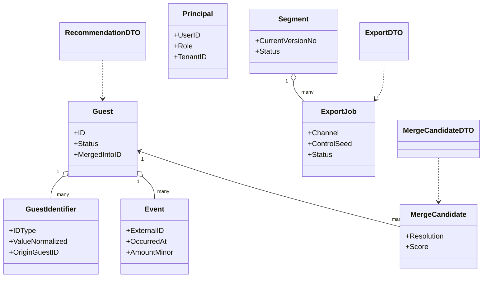

# 10. Class Diagrams

Диаграммы показывают контракты (Go-интерфейсы, `<<interface>>`) и их реализации, а не код. Правило слоёв: `handler → service → repository`, зависимости направлены внутрь к `domain`; интерфейсы репозиториев и портов объявляются в `internal/domain` (потребитель владеет контрактом), реализации — в `internal/repository` (типы `*SQL`), `internal/ingestion`, `internal/identity`, `internal/recommend`, `internal/segments` и др. Во всех методах первым параметром идёт `ctx context.Context` (на диаграммах опущен для краткости, где не меняет смысл). Имена совпадают с глоссарием (02) и сигнатурами из 04. Mermaid: в `classDiagram` нет пакетов и приватности Go, поэтому слой указан в пояснении и в таблице. Из-за лимита ~15 узлов модель разбита на шесть диаграмм: CL-1 слои, CL-2 ingestion, CL-3 identity, CL-4 segments и recommend, CL-5 export, CL-6 domain и DTO сервисов.

## CL-1. Слои на примере импорта и профиля

Пояснение. `Handler` только разбирает HTTP, проверяет роль и маппит ответ; бизнес-правила (дубликат, формат, ограничения) живут в `Service`; `Repository` скрывает SQL, поэтому смена СУБД не затрагивает верхние слои. `Queue` — порт с реализацией `DBQueue` (`internal/platform/queue`) на таблице `job_queue` (D-8) и возможной заменой на брокер. Запись событий идёт через `EventRepo` из конвейера `ingestion.Pipeline` (CL-2), а не напрямую из `ImportService`. Тот же шаблон применяется ко всем остальным сервисам (`SegmentService`, `ExportService`, …).

## CL-2. Ingestion: CSVConnector и конвейер

Пояснение. Единственная реализация чтения источника — `ingestion.CSVConnector`: он читает CSV (XLSX сначала приводится к строкам, `convert_xlsx.go`) по `FieldMapping` и отдаёт строки `Row`. `ingestion.Pipeline` валидирует строки, нормализует ключи функциями пакета `identity/normalize` (`Phone`, `Email`, `Card`), пишет события, отклонённые строки и счётчики пачки. Общего интерфейса коннектора и реестра коннекторов в коде нет: пакет `ingestion/connector` содержит только `doc.go`; задание `connector.pull` обрабатывается `ImportService.processPull`. Нормализация общая с `identity`, чтобы ключи сравнивались одинаково.

## CL-3. Identity: Resolver и объединение

Пояснение. `identity.Resolver` вызывается воркером по заданию `identity.resolve` для пачки (`ResolveBatch`): ищет гостей по нормализованным ключам, создаёт гостя, прикрепляет событие или при конфликте ключей заводит кандидата в объединение (автообъединение либо ожидающая пара, Q-12). `MergeSQL` (`internal/repository`) — единственный код, который в одной транзакции переписывает `guest_id` и выставляет `origin_guest_id`; им пользуются и автообъединение, и ручные операции `IdentityService`, что гарантирует одинаковую обратимость (D-5, D-25). Запрет объединения (`MergeBlockRepo.HasBlock`) проверяется перед любым объединением. Отдельных типов политики и исполнителя слияния в коде нет. Повторное сопоставление при появлении нового идентификатора (`identity.rematch`) не реализовано (Q-42).

## CL-4. Segments и Recommend

Пояснение. `SegmentEvaluator` — контракт с двумя режимами: предпросмотр без записи (`Preview`) и полный расчёт состава (`Evaluate`); `segments.SqlEvaluator` строит параметризованный SQL по JSON-правилу и проверяет правило (`validateRule`), поэтому правило не превращается в произвольный запрос. Пересчёт одной версии выполняет `SegmentService.RecomputeVersion` по заданию `segment.recompute`. `recommend.WeightedRecommender` считает взвешенную сумму факторов функцией `ScoreCandidates` (похожие гости, смежность категорий, свежесть, приоритет арендатора, понижение конкурента), веса берутся из `config.RecommendConfig` (D-15); `AggregateSegment` агрегирует оценки по составу сегмента. Для гостя без истории применяется fallback `low_data` (A-21, D-37), прямые конкуренты не отсекаются, а понижаются множителем `competitor_penalty` (A-18, D-34). `recommend.Evaluator` по заданию `recommend.evaluate` оценивает выданные рекомендации через внешний `Ranker`.

## CL-5. Export и ограничение контактов

Пояснение. Канал (`domain.ExportChannel`: `sms`, `push`, `email`) определяет, какой тип идентификатора считается контактом (телефон для SMS и push, email для email, Q-21); формат (`domain.ExportFormat`: `csv`, `api`, `xlsx`) определяет вид результата (Q-20); оба — строковые типы, а не интерфейсы. `ExportService` оркестрирует: фильтр по контакту, самое строгое правило из `ContactLimitRepo` по счётчикам `ContactLogRepo`, выбор контрольной группы функцией `pickControl` (детерминированно по `control_seed`, D-17) и транзакционную запись через `ExportRepo.Insert`. Файлы собирают функции `export.CSV` и `export.XLSX`. Выгрузка всегда строится синхронно в запросе. `ContactLimitService` управляет только правилами `contact_limit` (CRUD). Внешние провайдеры не вызываются, система только отдаёт данные.

## CL-6. Domain и DTO сервисов

Пояснение. `internal/domain` не зависит от HTTP и SQL: это структуры E-1…E-21 (показаны ключевые) и значения вроде `Principal`. DTO (`ExportDTO`, `MergeCandidateDTO`, `RecommendationDTO`, `ImportDTO` и др.) определены в `internal/service` и собираются сервисами, чтобы JSON-контракт не диктовал форму таблиц; пакет `internal/handler/dto` содержит только `doc.go`. Для R-3 ответы строятся отдельными видами без идентификаторов гостей (`TenantGuestSQL`, `service/tenant_aggregate.go`, фильтры приватности в `internal/handler`). `Principal` передаётся только через `context.Context`.
