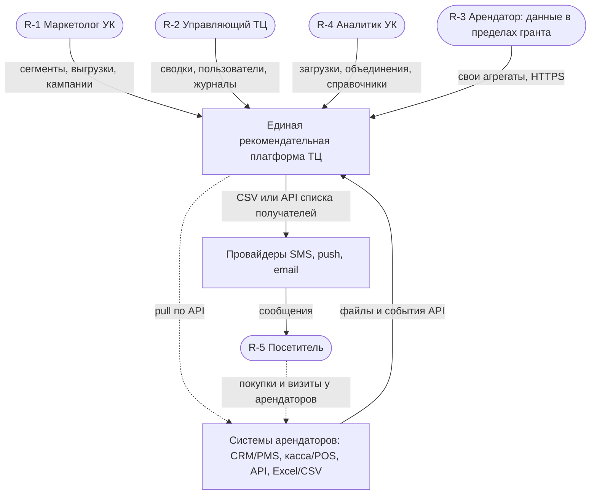
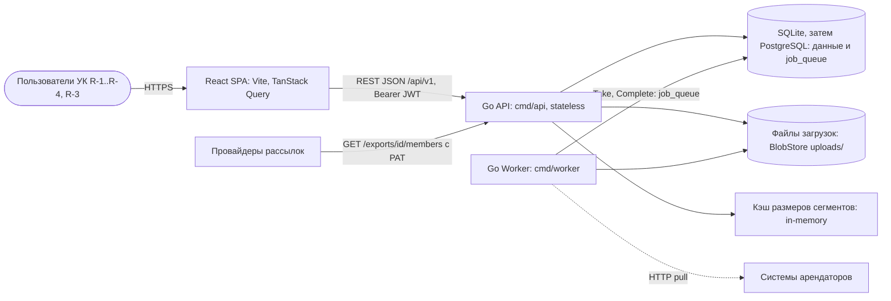
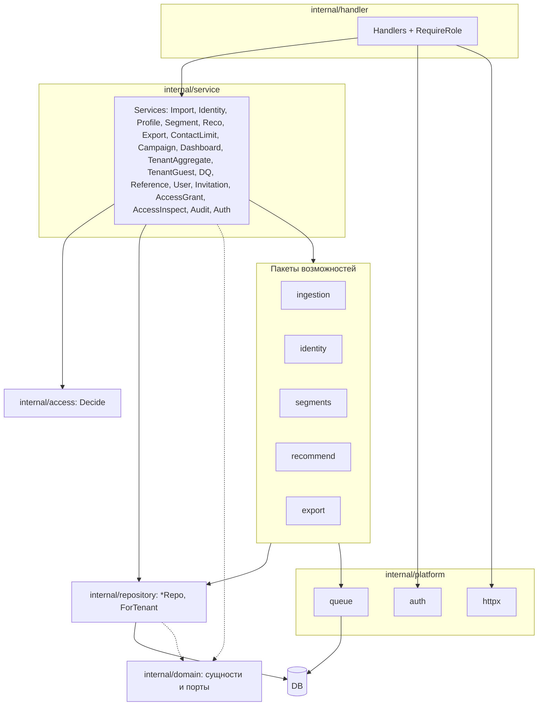
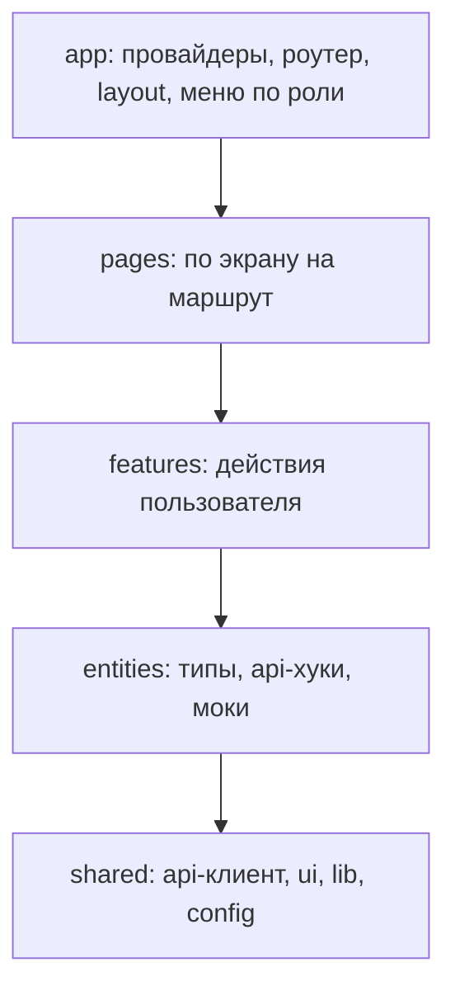
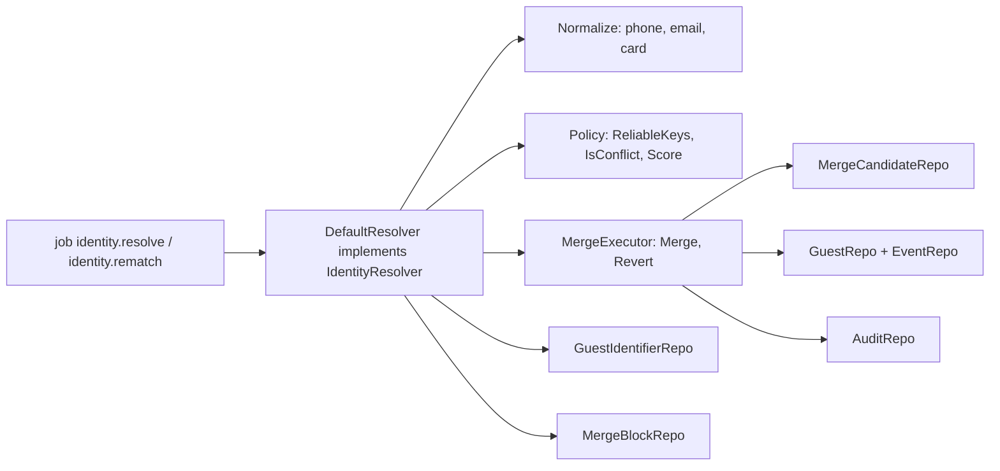

# 12. C4: Context, Container, Component, Code

Нативная нотация Mermaid `C4Context` экспериментальная и нестабильна, поэтому используется `flowchart`: прямоугольники — системы/контейнеры, «стадионы» — люди, цилиндры — хранилища, пунктир — исходящие/асинхронные связи. ID: C4-L1, C4-L2, C4-L3a (backend), C4-L3b (frontend), C4-L4 (identity). Согласовано с компонентами CMP-1…CMP-11 (`11-component-diagram.md`), последовательностями SD-1…SD-8 и потоками DFD (`13-dfd.md`).

## C4-L1. System Context

Пояснение. Платформа принимает данные арендаторов и превращает их в единый профиль, рекомендации и сегменты; это B2B2C-продукт: решает и платит УК (R-2), работает маркетолог (R-1) и аналитик (R-4), выгоду получает посетитель (R-5). Сообщения платформа сама не отправляет (допущение 0.3): она отдаёт получателей провайдерам через CSV или API, а провайдеры связываются с посетителем. Арендатор (R-3) получает только обезличенные агрегаты о себе и не видит данные других арендаторов; события посетителя возникают в системах арендаторов, откуда попадают в платформу.

## C4-L2. Container

Пояснение. SPA общается с backend только через REST. API не хранит состояние (JWT в заголовке), поэтому масштабируется горизонтально; тяжёлые операции (импорт, пересчёт сегментов, рекомендации, большие выгрузки) уходят в очередь, которую обслуживает отдельный процесс `Worker` из той же кодовой базы. Очередь — таблица `job_queue` в основной БД (D-8), поэтому отдельного брокера нет; кэш размеров — in-process (D-27), файлы загрузок — локальный каталог за интерфейсом `BlobStore` (D-28). Провайдеры в режиме API читают получателей выгрузки с персональным токеном R-1 (D-16, Q-24); арендатор R-3 использует тот же SPA, но маршруты ограничены одним разделом.

## C4-L3a. Component: Go API и Worker

Пояснение. Слои соответствуют структуре `apps/api/internal` (`ARCHITECTURE.md`): `handler` зависит от `service`, `service` оркестрирует пакеты возможностей и репозитории, `repository` единственный слой, знающий SQL. Каждый пакет возможностей соответствует компоненту (`ingestion` — CMP-1, `identity` — CMP-2, `segments` — CMP-4, `recommend` — CMP-5, `export` — CMP-6), `platform/auth` реализует CMP-8. Изоляция R-3 проходит через `RequireRole` в `handler`, `access.Decide` и проверку `tenant_id` в `service`, методы `...ForTenant` в `repository`. Воркер использует те же пакеты возможностей, но входит через `platform/queue`, а не через `handler`. `domain` не зависит ни от чего.

## C4-L3b. Component: React SPA

Пояснение. Структура `apps/web/src` — облегчённый FSD, импорты идут только вниз (`app → pages → features → entities → shared`), подробные правила в `ARCHITECTURE.md`. Меню строится по роли из `GET /auth/me`; для роли `tenant` доступен экран агрегатов, остальные маршруты отдают страницу 403 (дублирование защиты backend, не замена). Данные запрашиваются только через хуки `entities/*/api` и `features/*/api`, а `shared/api` единообразно обрабатывает 401 (обновление токена), 403, 409 и 504. Опрос статусов (импорт 2 с, сегмент и рекомендации 5 с) реализован на TanStack Query (D-22).

## C4-L4. Code: модуль identity

Пояснение. Для чанка событий `DefaultResolver` нормализует ключи, ищет владельцев в `guest_identifier`, затем проверяет запрет объединения; `Policy` решает, автообъединение это или спорная пара (порог score 80, Q-12). Любое слияние выполняет только `MergeExecutor` в одной транзакции: обновляет `guest_id` у `event` и `guest_identifier` с сохранением `origin_guest_id`, переводит проигравшего в `merged`, пишет `merge_candidate` и аудит. `Revert` делает обратное по `origin_guest_id` и создаёт запись `merge_block` (D-5, D-25). Модуль не знает о HTTP; REST-операции R-4 попадают в него через `IdentityService`.
