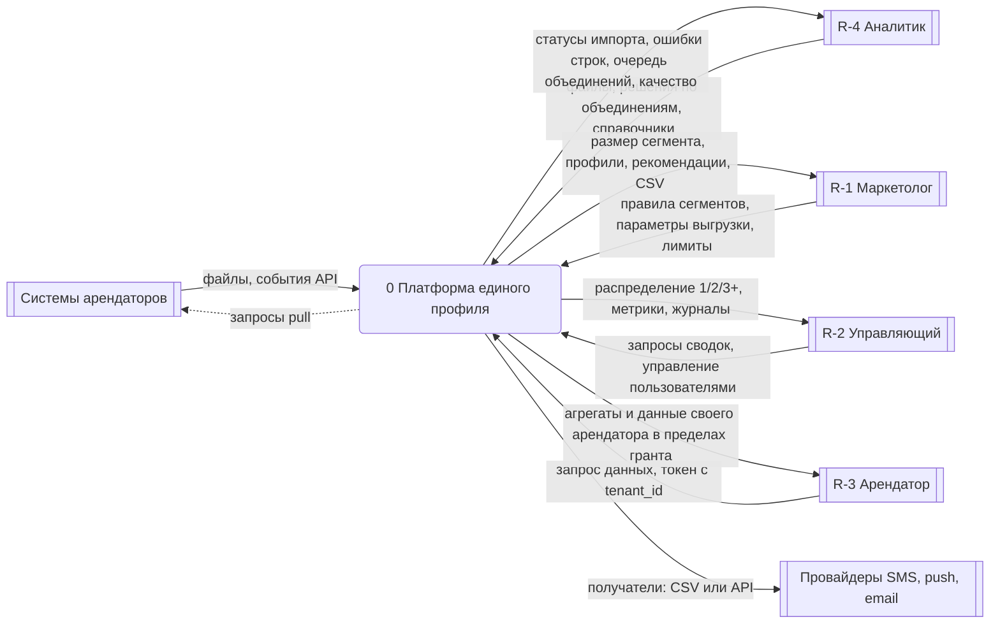
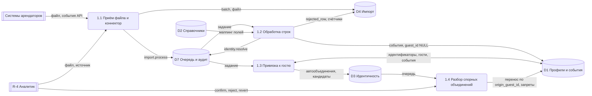
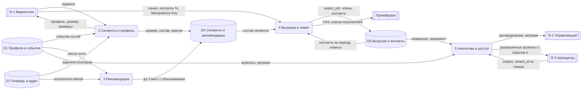

# 13. DFD уровни 0 и 1

Нотация в Mermaid `flowchart`: внешние сущности — прямоугольники с двойными границами (`[[ ]]`), процессы — скруглённые узлы `( )`, хранилища — цилиндры `[( )]`. Потоки подписаны данными. ID: DFD-0, DFD-1A (приём и идентификация), DFD-1B (сегменты, рекомендации, выгрузка, аналитика). Потоки согласованы: с C4 (контейнеры и связи, `12-c4.md`), с Sequence (SD-2 импорт, SD-3 коннектор, SD-4 сегмент, SD-5 выгрузка, SD-6 объединение, SD-7 изоляция R-3) и с ER (хранилища D1…D7 собраны из таблиц миграций).

## Хранилища данных

| ID  | Хранилище                                               | Таблицы ER                                                                                                                                                                 | Пишут процессы             | Читают процессы            |
| --- | ------------------------------------------------------- | -------------------------------------------------------------------------------------------------------------------------------------------------------------------------- | -------------------------- | -------------------------- |
| D1  | Профили и события                                       | `guest`, `guest_identifier`, `event`                                                                                                                                       | P1.2 (event), P1.3         | P2, P3, P4, P5             |
| D2  | Справочники                                             | `mall`, `tenant`, `tenant_category`, `tenant_category_relation`, `project`, `event_type`, `data_source_type`, `data_source`                                                | P5 (администрирование R-4) | P1, P3, P4, P5             |
| D3  | Идентичность                                            | `merge_candidate`, `merge_block`                                                                                                                                           | P1.3, P1.4                 | P1.4, P5                   |
| D4  | Импорт                                                  | `import_batch`, `rejected_row`, файлы `BlobStore`                                                                                                                          | P1.1, P1.2                 | P1.2, P5                   |
| D5  | Сегменты и рекомендации                                 | `segment`, `segment_version`, `segment_member`, `recommendation`, `recommendation_factor`, `recommendation_eval`, `campaign`                                               | P2, P3                     | P2, P3, P4                 |
| D6  | Выгрузки и контакты                                     | `export_job`, `export_member`, `contact_limit`, `contact_log`                                                                                                              | P4                         | P4, P5                     |
| D7  | Очередь, аудит, доступ (в диаграммах «Очередь и аудит») | `app_user`, `audit_log`, `job_queue`, `user_invitation`, `permission`, `role_permission`, `access_grant`, `access_grant_item`, `access_grant_scope`, `access_policy_state` | все процессы (аудит), P0   | P0, P1.2, P1.3, P2, P3, P5 |

## DFD-0. Контекстная диаграмма (уровень 0)

Пояснение. Платформа — единый процесс между шестью внешними сущностями. Данные входят от арендаторов (файлы и API) и аналитика (решения, справочники), выходят маркетологу, управляющему, аналитику и провайдерам; посетитель (R-5) внешней сущностью DFD не является, поскольку напрямую с системой не взаимодействует (он получает сообщение от провайдера). Арендатор имеет один входящий и один исходящий поток: запрос и ответ в пределах гранта (по умолчанию — обезличенные агрегаты своего арендатора); контур изолирован проверкой `access.Decide` и фильтром `tenant_id` из токена.

## DFD-1A. Уровень 1: приём и идентификация

Пояснение. Файл или событие API проходят цепочку 1.1→1.2→1.3, где границы между процессами проходят через очередь (хранилище D7), что совпадает с SD-2 и SD-3. Процесс 1.2 пишет события в D1 без привязки и ошибки в D4; 1.3 ищет и объединяет профили (AD-2), автообъединения и спорные пары фиксирует в D3. Процесс 1.4 — действия R-4 над D3; разъединение возвращает данные по `origin_guest_id` и создаёт запрет. В D7 записывается аудит любого изменения профилей; после привязки 1.3 ставит `segment.recompute` и `recommend.refresh` (потоки в DFD-1B).

## DFD-1B. Уровень 1: сегменты, рекомендации, выгрузка, аналитика

Пояснение. Процесс 2 строит сегменты (предпросмотр читает D1 напрямую, SD-4; пересчёт запускается заданием `segment.recompute` из D7; состав материализуется в D5), процесс 3 пересчитывает рекомендации по заданию из D7 (AD-4), процесс 4 читает состав из D5, контакты и лимиты из D6, пишет выгрузку и отдаёт получателей провайдеру (SD-5, AD-5). Процесс 5 строит метрики и сводки: R-2 получает сводные данные, R-3 получает только агрегаты своего арендатора; в процесс 5 для R-3 не доходит ни одной строки гостя: репозиторий применяет `WHERE tenant_id = claim`, малые ячейки скрываются (k=5). Данные D6 (журнал контактов) нужны одновременно лимитам и расчёту конверсии, поэтому читаются процессами 4 и 5. Диаграмма разделена на два уровня-листа ради лимита узлов; аудит и R-4 в ней не показаны (см. DFD-1A).

## Сверка потоков

| DFD-поток           | Sequence      | C4                                   |
| ------------------- | ------------- | ------------------------------------ |
| TS → 1.1 → D4/D7    | SD-2, SD-3    | L2: SPA/API → БД, Worker → HTTP pull |
| 1.2 → D1/D4         | SD-2 (worker) | L3a: `ingestion` → `repository`      |
| 1.3, 1.4 ↔ D1, D3   | SD-6          | L3a, L4 identity                     |
| R-1 → P2 → D5       | SD-4          | L3a: `segments`                      |
| P4 → D6, PRV        | SD-5          | L2: PRV → API (members)              |
| R-3 ↔ P5            | SD-7          | L1, L2, L3a: RequireRole + ForTenant |
| D7 (аудит, очередь) | SD-1…SD-6     | L2: БД с `job_queue`                 |
