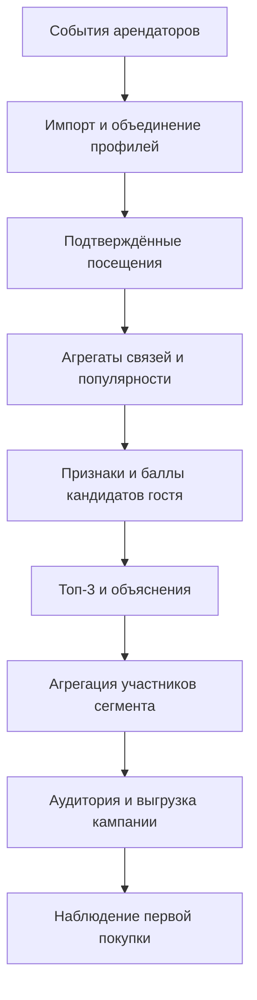

# Предложение: рекомендации гостям и сегментам

> **Статус: проектное предложение, не реализованная модель и не утверждённое изменение требований.** Документ описывает возможное развитие рекомендателя UCRP для хакатона и последующего пилота. Формулы, веса и параметры требуют проверки и согласования. Текущее состояние кода рассмотрено по `main`, коммит `7f38d3e`.

## 1. Задача и границы

Торговый центр объединяет события разных арендаторов в профиль гостя. Маркетологу нужно определить, в какое новое для гостя место его разумно пригласить, и сформировать подходящую аудиторию для кампании.

Главная метрика заказчика — **первая покупка гостя у нового для него арендатора или проекта**. Необходимо проследить путь от гостя и сегмента через рекомендацию и кампанию до подтверждённого результата. Для хакатона допустима демонстрация на синтетических данных. Вопросы о типах событий и главной метрике описаны в [ответах заказчика](../requirements/customer-faq.md).

У модели две задачи:

1. **Для гостя:** упорядочить допустимых арендаторов и показать до трёх с понятными причинами.
2. **Для сегмента:** определить, каким участникам сегмента подходит каждый арендатор, и показать охват для кампании.

Синтетика позволяет проверить работоспособность и исследовать модель в искусственно заданных условиях. Она не доказывает увеличение реальных покупок. Балл релевантности не является вероятностью покупки или оценкой эффекта коммуникации.

## 2. Что уже есть

Текущий [персональный рекомендатель](../../apps/api/internal/recommend/recommender.go) (версия алгоритма `v2`, [скоринг](../../apps/api/internal/recommend/scoring.go)) уже реализует значительную часть предложения. Он отбирает активных арендаторов, исключает места с подтверждённым посещением гостя за всю историю и для каждого кандидата считает взвешенную сумму факторов: поведенческая близость (косинус по общим гостям со сглаживанием `λ = 5`, вес посещений затухает по давности с периодом полураспада 180 дней, окно связей 365 дней), смежность категорий, популярность среди гостей окна и нормированный приоритет арендатора. Веса по умолчанию — 0,45 / 0,15 / 0,25 / 0,15; для кандидата из категории-конкурента балл умножается на `0,7`. Для гостя без истории или без статистики по кандидату используется резервная оценка по популярности и приоритету с пометкой «мало данных». Сортировка по убыванию балла, при равенстве по `tenant_id`; возвращаются максимум три рекомендации. Параметры задаются переменными окружения `UCRP_RECOMMEND_*`. Фактор расстояния в расчёте не используется, момент расчёта `T` — текущее время, а не фиксированный снимок.

Факторы и объяснение сохраняются: таблица `recommendation_factor` заполняется, API гостя возвращает `factors`, название арендатора, категорию и этаж. Новая выдача заменяет предыдущую целиком (история решений не хранится). Пересчёт запускается заданием очереди `recommend.refresh` после импорта и идентификации и принудительным запросом.

Рекомендации сегмента строятся [агрегацией](../../apps/api/internal/recommend/segment_agg.go) персональных результатов его участников: для арендатора считаются `guests` (в топ-3 у участника, который его не посещал), `eligibleCount`, `segmentCount`, `averageScore` по тем, у кого арендатор попал в топ-3, и `incompleteCount` — подходящие участники без свежего (моложе 24 часов) расчёта. Результат сортируется по числу гостей, затем по среднему баллу; значения меньше порога k = 5 скрываются (`suppressed`). Ограничение прежнее: хранится только топ-3 на гостя, поэтому агрегат измеряет попадание в топ-3, а не релевантность среди всех подходящих гостей.

Дополнительно есть задание `recommend.evaluate`: если задан `UCRP_KEV_BASE_URL`, воркер отправляет топ-3 гостя с журналом его действий во внешний сервис Kev и сохраняет распределение и порядок в `recommendation_eval`. Выдача от этого не меняется, результат через API не отдаётся.

Схема и таблицы описаны в [миграции](../../apps/api/migrations/common/00001_init.sql).

## 3. Общая схема



Расчёт связей выполняется периодически по данным, доступным на выбранный момент. Личный рейтинг можно пересчитывать после обновления профиля или по запросу. Принятые в проекте ориентиры — обновление после приёма события в пределах минуты (A-9) и бюджет принудительного пересчёта рекомендаций 10 секунд (Q-23). Это проектные допущения, а не измеренное SLA. Период массового обновления связей и достижимость ориентиров для новой модели нужно подтвердить измерениями.

Подход к разделению отбора, скоринга и дополнительного ранжирования используется в рекомендательных системах; обзор этапов приводит [Google](https://developers.google.com/machine-learning/recommendation/overview/types). При каталоге порядка 80–150 арендаторов проекта можно сначала оценивать всех допустимых кандидатов: отдельный механизм поиска по огромному каталогу не обязателен.

## 4. Какие данные использовать

| Данные                                           | Роль в расчёте                                        |
| ------------------------------------------------ | ----------------------------------------------------- |
| `event.guest_id`, `tenant_id`, `occurred_at`     | Посещения гостя и связи между арендаторами            |
| `event_type.counts_as_presence`                  | Отбор типов событий, которые подтверждают присутствие |
| `event.reverses_event_id`                        | Данные для согласованной обработки отмен и возвратов  |
| `tenant.category_id`, `tenant_category_relation` | Близость категорий и понижение прямых конкурентов     |
| `tenant.floor`, `x_m`, `y_m`                     | Возможный фактор расстояния, если данные заполнены    |
| `tenant.priority`, `is_active`                   | Бизнес-приоритет и допустимость кандидата             |
| `segment_version`, `segment_member`              | Участники актуальной версии сегмента                  |
| `recommendation`, `recommendation_factor`        | Текущий результат и предусмотренные схемой факторы    |

Для одного расчёта задаётся момент `T`. События и другие признаки должны быть известны системе к этому моменту. Для ретроспективной оценки важно учитывать не только дату события, но и дату его поступления: поздно загруженное событие не должно попадать в прошлый снимок. История объединения профилей и доступность арендаторов также не должны давать знания из будущего.

**Отсутствие события означает отсутствие записи в доступных источниках.** Это не доказательство того, что человек физически не посещал арендатора, и не отрицательная оценка. Неявная обратная связь и её ограничения рассматриваются в работе [Hu, Koren и Volinsky](https://yifanhu.net/PUB/cf.pdf).

Для расчёта совместной посещаемости берётся согласованное временное окно. В пределах окна один канонический гость учитывается у одного арендатора один раз, даже если у него несколько покупок. Правила влияния полного или частичного возврата на факт посещения нужно согласовать с источниками данных: возврат не всегда означает, что визита не было.

## 5. Модель для гостя

### 5.1. Отбор допустимых арендаторов

На момент `T` рассматриваются активные арендаторы. Из персональной выдачи исключаются места с зарегистрированным подтверждённым посещением гостя за **всю доступную историю до `T`**, а не только за окно расчёта похожести. Если допустимых кандидатов нет, результат пустой и это не ошибка.

Прямой конкурент по умолчанию не исключается: действующее решение проекта предусматривает понижающий фактор. Настраиваемое исключение на уровне категории остаётся отдельной возможностью. См. D-34 в [открытых вопросах и решениях](../requirements/00-open-questions.md).

### 5.2. Связь двух арендаторов

Пусть для одного окна и одного набора гостей:

- `nA` — число уникальных гостей с подтверждённым посещением A;
- `nB` — число уникальных гостей с подтверждённым посещением B;
- `nAB` — число уникальных гостей, посетивших и A, и B.

Предлагаемый признак связи:

```text
similarity(A, B) = nAB / sqrt(nA × nB) × nAB / (nAB + λ)
```

Первый множитель — косинусная близость бинарных множеств посетителей. Второй уменьшает значение для пар с небольшой поддержкой. `λ > 0` — параметр сглаживания, а не измеренная характеристика гостей. Если `nA` или `nB` равны нулю, статистической оценки для пары нет; её нельзя считать доказательством отсутствия интереса.

Связь симметрична: она описывает **совместные посещения**, не порядок «сначала A, потом B» и не причинное влияние. Косинус и сглаживание не устраняют смещение к популярным местам полностью. Их влияние нужно проверять на отдельных группах и по охвату арендаторов.

Подход item-to-item применяется в индустрии; историю его развития описывают инженеры [Amazon](https://www.amazon.science/publications/two-decades-of-recommender-systems-at-amazon-com). Приведённое здесь сглаживание и вся итоговая формула — предложение для UCRP; источник не доказывает их превосходство на данных торгового центра.

### 5.3. Признак гостя и итоговый балл

Пусть `H` — арендаторы из подходящей истории гостя, для которых доступен расчёт, а `rA` — вес посещения A с учётом давности. Для допустимого кандидата B:

```text
behavior(guest, B) = Σ(rA × similarity(A, B)) / Σ(rA), для A из H
```

В знаменателе учитываются все подходящие места из `H`, включая места с нулевым числом общих гостей с B. Это не даёт одной слабой связи искусственно определять весь результат. Правило веса давности и его параметры согласуются отдельно.

Если истории гостя нет, знаменатель равен нулю или у кандидата нет статистики, поведенческий признак недостаточно определён. Используется резервная оценка по доступным данным — популярности и приоритету, при наличии также категориям — с пометкой «мало данных». Отсутствующий признак не следует незаметно приравнивать к измеренному нулю. Если резервные и обычные оценки попадают в одну выдачу, их сопоставимость и порядок при смешении нужно определить и проверить отдельно: одинаковый диапазон сам по себе не гарантирует сопоставимости.

Другие признаки можно нормировать в диапазон `[0, 1]` и объединить:

```text
base_score = w_behavior × behavior
           + w_category × category_affinity
           + w_popularity × popularity
           + w_priority × priority_normalized

score = base_score × competition_multiplier
```

Веса неотрицательны, их сумма равна 1; понижающий множитель находится в `[0, 1]`. `priority_normalized = priority / 100`. Конкретные веса, расчёт близости категорий, обработка отсутствующих признаков и сила понижения — предмет проверки. Правила объединения нескольких конкурентных отношений тоже требуют согласования.

Ранее в проекте уже зафиксированы ориентиры весов и размещение настроек в конфигурации с версией алгоритма. Новые значения в этом документе не заменяют решения A-14 и D-15 из [реестра решений](../requirements/00-open-questions.md). Расстояние допустимо добавить как отдельный признак после определения единиц и правил для отсутствующих координат.

Баллы сортируются по убыванию, при равенстве используется стабильный `tenant_id`. Затем выбираются до трёх кандидатов. У каждой рекомендации сохраняются версия алгоритма, время и фактические вклады признаков. Объяснение строится из рассчитанных факторов; например: «другие гости также посещали кинотеатр» и «категории смежные». Количество гостей в тексте должно соответствовать данным, использованным в расчёте.

### 5.4. Полный искусственный пример

Пусть в окне есть шесть гостей:

| Гость | Посещённые арендаторы |
| ----- | --------------------- |
| 1     | A, B, C               |
| 2     | A, B, C               |
| 3     | A, C                  |
| 4     | A                     |
| 5     | B                     |
| 6     | B                     |

Для гостя 3 арендатор B ещё не посещён. Получаем `nA = 4`, `nB = 4`, `nC = 3`, `nAB = 2`, `nCB = 2`. **Только для примера** возьмём `λ = 2`, веса давности A = 1 и C = 0,5:

```text
similarity(A, B) = 2 / sqrt(4 × 4) × 2 / (2 + 2) = 0,250
similarity(C, B) = 2 / sqrt(3 × 4) × 2 / (2 + 2) ≈ 0,289
behavior(гость 3, B) = (1 × 0,250 + 0,5 × 0,289) / 1,5 ≈ 0,263
```

Если для примера популярность B среди этих шести гостей равна `4 / 6 ≈ 0,667`, приоритет — `60 / 100 = 0,6`, а временно выбранные веса поведения, популярности и приоритета — `0,6`, `0,25`, `0,15`, то без других факторов:

```text
score ≈ 0,6 × 0,263 + 0,25 × 0,667 + 0,15 × 0,6 ≈ 0,414
```

Это **учебный пример**, а не утверждённые веса и не прогноз конверсии 41,4%. Его цель — показать, как можно воспроизвести каждый вклад.

## 6. Модель для сегмента

Сегментная рекомендация строится из персональных результатов участников **актуальной версии сегмента** на согласованном снимке данных и версии алгоритма. Это один из возможных способов агрегировать индивидуальные предпочтения; исследования групповых рекомендаций рассматривают разные стратегии агрегации, но маркетинговый сегмент UCRP имеет собственную цель — охват подходящих гостей, а не выбор общего действия для всей группы. См. [Design and evaluation of a group recommender system](https://doi.org/10.1145/2365952.2366000).

Для каждого арендатора B считаются:

- `segment_count` — все участники актуальной версии сегмента;
- `eligible_count` — участники, у которых нет зарегистрированного присутствия у активного B;
- `recommended_count` — уникальные подходящие участники, у которых B есть в актуальном персональном топ-3;
- доли `recommended_count / segment_count` и `recommended_count / eligible_count`;
- `average_score` — средний балл **только среди тех, кому B попал в топ-3**;
- число подходящих для B участников, для которых персональный расчёт отсутствует или устарел.

Пример: в сегменте 10 гостей, из них 6 подходят для B, а у 3 B входит в топ-3. Охват — **30% всего сегмента** и **50% подходящих**. Если оценки этих трёх равны `0,60`, `0,45`, `0,30`, их среднее — `0,45`. Оставшиеся три подходящих гостя не получают автоматически нулевой балл: их оценка может быть неизвестна или находиться вне топ-3.

Для демо можно сортировать арендаторов по `recommended_count`, затем по среднему баллу и стабильному ID. При нулевом знаменателе долю следует обозначать как неприменимую. Если расчёты для части подходящих гостей отсутствуют или устарели, охват и средний балл предварительные: рядом нужно показывать количество таких гостей для B и не считать отсутствие расчёта нулевой оценкой. До выгрузки нужно повторно проверить актуальность допустимости, наличие контакта и лимиты; экспортируемая аудитория может быть меньше рекомендованной.

Таблица `recommendation` хранит только три рекомендации на гостя. Поэтому такая агрегация измеряет **попадание в топ-3**, а не среднюю релевантность среди всех подходящих гостей. Полный сегментный рейтинг по всем кандидатам потребует отдельного расчёта или более полного снимка оценок.

## 7. Как реализовать в текущем бэкенде

Часть шагов уже выполнена (см. §2): связи и популярность считаются в `repository.PresenceSQL`, скоринг и объяснения — в `internal/recommend`, сегментная агрегация и пересчёт через очередь работают. Ниже — что остаётся уточнить или добавить.

1. **SQL и репозитории.** Получать допустимые посещения и признаки арендаторов, строить пары `guest_id + tenant_id` без повторов, агрегировать `nA`, `nB`, `nAB` и популярность. При необходимости хранить рассчитанные связи с границами окна, временем снимка и версией; формат хранения и миграция определяются при реализации.
2. **`internal/recommend`.** Рассчитывать нормированные факторы, итоговую оценку, стабильную сортировку и объяснения. SQL-выборки размещать в `repository`, а доменные контракты — в `domain` в соответствии с [архитектурой](../../ARCHITECTURE.md).
3. **Сохранение.** Записывать текущие топ-3 и факторные вклады. Для воспроизводимой оценки кампаний дополнительно потребуется сохранять историю решений и связь с кампанией: текущий `replace` удаляет предыдущую выдачу.
4. **Сегмент.** Агрегация актуальных персональных результатов с отдельным учётом непересчитанных гостей реализована (поля описаны в [OpenAPI](../../packages/openapi/components/schemas/recommendations.yaml)). Для полного сегментного рейтинга по всем кандидатам нужен отдельный расчёт или более полный снимок оценок.
5. **Обновление.** После импорта и идентификации пересчёт затронутых рекомендаций уже идёт через очередь (`recommend.refresh`); общие связи (`nA`, `nB`, `nAB`) сейчас считаются на каждый пересчёт гостя, периодическое обновление и кэширование связей остаются предметом измерений.
6. **Экспорт и результат.** Связывать сегмент, целевого арендатора, снимок рекомендаций и кампанию. Различать формирование выгрузки, подтверждённую отправку и покупку, если источник доставки доступен: текущий `ContactLog` создаётся при подготовке выгрузки и сам по себе отправку не подтверждает.

Для 150 арендаторов возможны `150 × 149 / 2 = 11 175` неориентированных пар. Это ограничивает размер итогового набора пар, но **не доказывает**, что пересчёт всей истории будет быстрым: стоимость зависит от числа событий и посещённых мест на гостя. Запросы и обновление нужно измерить на ожидаемом объёме данных.

## 8. Почему подход применим к разным сценариям

«Универсальнее» здесь означает применимость к разным категориям и возможность менять состав факторов. Это **не утверждение, что модель точнее любой альтернативы**.

| Подход                                              | Сильная сторона                                                                                 | Ограничение для UCRP                                                                                   |
| --------------------------------------------------- | ----------------------------------------------------------------------------------------------- | ------------------------------------------------------------------------------------------------------ |
| Прежний рекомендатель (приоритет + бонус за топ-10) | Быстро работает и прост для демонстрации                                                        | Сила поведенческого сигнала внутри топ-10 не влияла на балл; заменён версией `v2`                      |
| Только вручную заданные правила                     | Понятны бизнесу и работают без статистики                                                       | Нужно отдельно поддерживать множество сочетаний и исключений                                           |
| Гибрид связей и факторов (основа `v2`)              | Единая основа для гостя и сегмента; причины можно разложить; резервная выдача при малой истории | Зависит от качества объединения и истории; популярность и настройки могут сместить выдачу              |
| Обучаемая рекомендательная модель                   | Может учить сложные зависимости на подходящих данных                                            | Требует меток, оценки качества и обслуживания; преимущество для конкретного ТЦ нужно доказать          |
| Kev как дополнительный reranker                     | Может сравнивать короткий список с контекстом гостя и кандидатов                                | Добавляет время и инфраструктуру; порядок и вероятности выбора сами по себе не доказывают рост покупок |

Kev может получать профиль и факторы кандидатов после базового расчёта, а при ошибке использоваться базовый порядок. Для одного вопроса `choice` API возвращает распределение по вариантам; сортировка этого распределения может служить экспериментальным порядком топ-3. Это не откалиброванная вероятность первой покупки в данном ТЦ. Возможности `choice` и дообучения описаны в [репозитории Kev](https://github.com/jaredpalmer/kev#api). Если Kev переставил выдачу, факторы базовой модели объясняют соответствие кандидата, но не обязательно причину именно этой перестановки. В коде сейчас только оценка без перестановки: задание `recommend.evaluate` (см. §2) сохраняет ответ Kev в `recommendation_eval`, а порядок топ-3 остаётся базовым.

## 9. Проверка до демонстрации и на пилоте

На синтетических данных нужны отдельно подготовленные сценарии и набор для проверки, а не только данные, повторяющие логику генератора:

1. Повторные покупки одного гостя не увеличивают число уникальных гостей пары.
2. Посещённый и неактивный арендаторы не попадают в персональную выдачу; гость без истории получает помеченный fallback.
3. Редкая пара сглаживается; категории, приоритет и конкурент влияют согласно конфигурации.
4. Рекомендация сегмента считает уникальных гостей и оба знаменателя; непересчитанные гости видны отдельно.
5. Новое событие приводит к пересчёту, а повторная обработка не создаёт дубликаты.

Для сравнения качества использовать хотя бы популярность, текущий скоринг и предлагаемую модель. Для офлайн-проверки выбрать общий момент `T`, построить признаки только по данным, доступным до него, и сравнить топ-3 с первой наблюдаемой покупкой у нового допустимого арендатора в последующем окне. `Hit@3` считается по гостям, для которых такая покупка наблюдалась; размер этой группы и покрытие всех гостей показываются отдельно. Окно, тип события покупки и правила отмен нужно определить заранее.

Такой показатель проверяет совпадение с наблюдаемым будущим событием, но не эффект рекомендации. Временная отсечка должна применяться ко всем гостям и агрегатам: иначе сведения о будущем одного гостя могут повлиять на рекомендацию другому. Риск такой утечки рассматривается в [исследовании RecSys 2025](https://dl.acm.org/doi/full/10.1145/3705328.3759329).

На реальном пилоте эффект коммуникации предлагается измерять отдельно: случайно распределить подходящих гостей в группу назначения коммуникации и контроль, затем сравнить долю первых покупок у целевого арендатора за одинаковое окно. Группы сохраняются в анализе по первоначальному назначению; фактическая отправка и доставка учитываются отдельно. Размер выборки, неопределённость и возможность пересечения кампаний влияют на выводы. Подход к экспериментальной оценке дополнительного эффекта описан в [исследовании ASOS и Imperial College](https://arxiv.org/html/1806.02588v2).

## 10. Открытые решения перед реализацией

- Период расчёта связей и популярности, периодичность их обновления и подтверждение проектных ориентиров задержки нагрузочными измерениями.
- Типы событий покупки и присутствия по источникам; влияние полных и частичных возвратов.
- `λ`, вес давности, факторы и веса итогового скоринга; соответствие уже принятым A-14 и D-15.
- Обработка отсутствующих признаков и малого числа наблюдений, включая новых арендаторов; сопоставимость резервных и обычных баллов.
- Правило понижения при нескольких отношениях конкуренции и необходимость разнообразия топ-3.
- Срок актуальности персональных результатов и поведение сегментного расчёта при неполном покрытии.
- Правила атрибуции, подтверждения отправки, окно первой покупки и условия эксперимента.

До согласования это параметры и варианты реализации, а не новые утверждённые требования.
