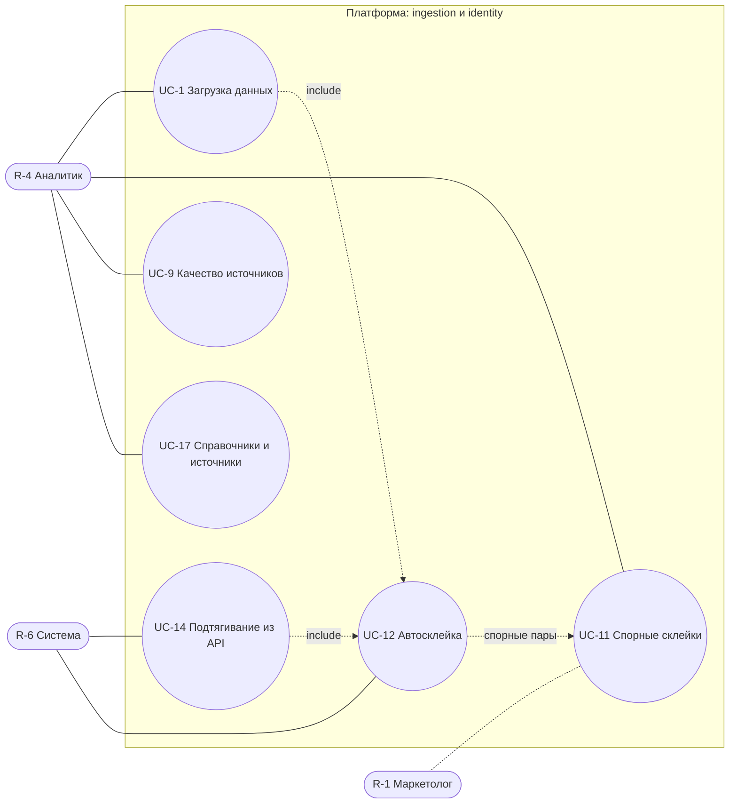
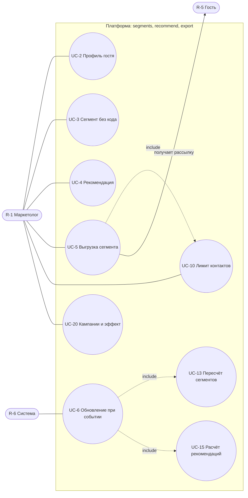
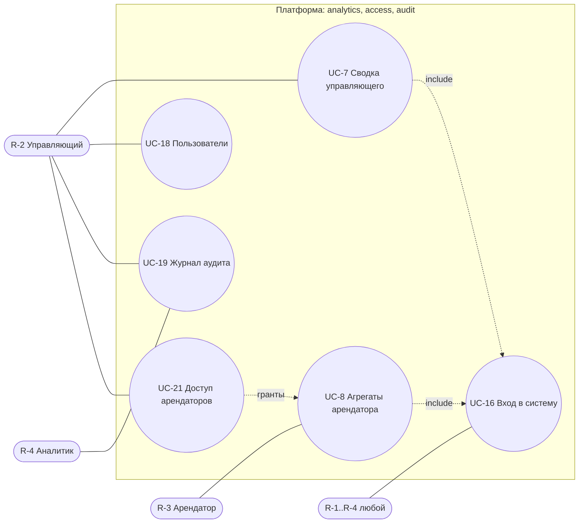

# 03. Use Case диаграммы и таблица UC

Mermaid не имеет нативной Use Case нотации: используется `flowchart` — актёры как скруглённые узлы, прецеденты как овалы `(( ))`, пунктир `include` — включение. Диаграммы разбиты на три, каждая ≤ 15 узлов. Соответствие UC-n ↔ US-n один-к-одному для n = 1…11; UC-12…UC-21 — служебные.

## 1. Диаграмма A: данные и идентичность

Пояснение. Аналитик (R-4) загружает файлы (UC-1), разбирает спорные склейки (UC-11), смотрит качество источников (UC-9) и ведёт справочники (UC-17); маркетолог (R-1) может только читать очередь склеек. Система (R-6) по расписанию подтягивает события из API (UC-14). Оба пути приёма событий включают автосклейку (UC-12), которая сливает профили по надёжным ключам, а спорные пары передаёт в UC-11. Разъединение (revert) — часть UC-11 и создаёт запрет склейки E-12. Диаграмма показывает только приём и идентификацию; сегменты и выгрузки — на диаграмме B.

## 2. Диаграмма B: сегменты, рекомендации, выгрузка

Пояснение. Маркетолог (R-1) смотрит профиль (UC-2), собирает сегмент (UC-3), получает рекомендации (UC-4), выгружает сегмент (UC-5) и задаёт лимит контактов (UC-10); эффект кампании оценивается в UC-20. Новое событие запускает UC-6, который включает пересчёт сегментов (UC-13) и рекомендаций (UC-15) без участия человека. Выгрузка всегда включает проверку лимита (UC-10) и фильтр по наличию контакта нужного канала. Посетитель (R-5) не работает с системой: он только получает рассылку через внешнего провайдера. Для аналитика (R-4) UC-2, UC-3, UC-4 тоже доступны, но на схеме опущены ради читаемости.

## 3. Диаграмма C: аналитика, доступ, администрирование

Пояснение. Управляющий (R-2) смотрит распределение гостей по числу арендаторов (UC-7), управляет пользователями (UC-18) и читает аудит (UC-19). Арендатор (R-3) работает с собственными данными (UC-8); объём определяется грантами, которые выдаёт R-2 (UC-21), а `tenant_id` берётся только из токена, чужие данные недоступны ни в UI, ни через API. Любой пользователь входит через UC-16, который включается в остальные. Аналитик (R-4) читает аудит, чтобы проверять склейки. Связи R-1 с UC-7 (чтение) на схеме не показаны.

## 4. Таблица UC

| UC    | Название                               | US                             | Актор            | Предусловие                         | Основной сценарий / результат                                                                                            | Включает     | Приоритет   |
| ----- | -------------------------------------- | ------------------------------ | ---------------- | ----------------------------------- | ------------------------------------------------------------------------------------------------------------------------ | ------------ | ----------- |
| UC-1  | Загрузка данных арендатора             | US-1                           | R-4              | Источник (E-5) создан               | Файл принят → 202 → построчная валидация → события в профиль; видны принятые/отклонённые строки; повтор файла без дублей | UC-12, UC-6  | MVP         |
| UC-2  | Просмотр единого профиля               | US-2                           | R-1 (R-4)        | Гость существует                    | Профиль, лента событий, число арендаторов                                                                                | —            | MVP         |
| UC-3  | Сборка сегмента без кода               | US-3                           | R-1 (R-4)        | Справочник арендаторов заполнен     | Правило «был/не был», период → размер до сохранения → сохранение → состав                                                | UC-13        | MVP         |
| UC-4  | Рекомендация гостю                     | US-4                           | R-1 (R-4)        | Есть события гостя (иначе fallback) | До 3 мест с обоснованием, без посещённых; конкуренты понижаются, не исключаются                                          | UC-15        | MVP         |
| UC-5  | Выгрузка сегмента в канал              | US-5                           | R-1              | Сегмент посчитан                    | Выбор канала → фильтр по контакту → лимит (если настроен) → опциональная контрольная группа → CSV/API → запись в журнал  | UC-10        | MVP         |
| UC-6  | Обновление при новом событии           | US-6                           | R-6              | Событие принято                     | Профиль обновлён → пересчёт сегментов и рекомендаций → изменение видно в UI                                              | UC-13, UC-15 | MVP         |
| UC-7  | Сводка управляющего                    | US-7                           | R-2              | Есть события                        | Распределение гостей по 1/2/3+ арендаторам, динамика                                                                     | UC-16        | 2-я очередь |
| UC-8  | Агрегаты арендатора                    | US-8                           | R-3              | Пользователь привязан к Tenant      | Только свои данные в пределах гранта (по умолчанию агрегаты со скрытием малых групп); чужие данные недоступны            | UC-16        | 2-я очередь |
| UC-9  | Качество данных по источникам          | US-9                           | R-4              | Были загрузки                       | Дата последней загрузки, доля отклонённых, число спорных профилей                                                        | —            | 2-я очередь |
| UC-10 | Ограничение частоты контактов          | US-10                          | R-1              | —                                   | Настройка лимита (необязательна); при наличии правила повторная отправка блокируется с причиной                          | —            | MVP         |
| UC-11 | Подтверждение и разъединение склеек    | US-11                          | R-4              | Есть кандидаты                      | Подтвердить/отклонить/разъединить за один шаг, запись в аудит, запрет повторной склейки                                  | —            | MVP         |
| UC-12 | Автосклейка профилей                   | — (поддерж. US-1, US-2, US-11) | R-6              | Событие с ключами                   | Поиск по надёжным ключам; слияние или кандидат (E-11)                                                                    | —            | MVP         |
| UC-13 | Пересчёт сегментов                     | — (поддерж. US-3, US-6)        | R-6              | Событие или правка правила          | Инкрементальный/полный пересчёт `segment_member`                                                                         | —            | MVP         |
| UC-14 | Подтягивание событий из API            | — (поддерж. US-1)              | R-6              | Источник типа API с расписанием     | Pull окна событий → ImportBatch mode=pull                                                                                | UC-12        | MVP         |
| UC-15 | Расчёт рекомендаций                    | — (поддерж. US-4, US-6)        | R-6              | События гостя изменились            | Скоринг → ≤ 3 рекомендаций + факторы                                                                                     | —            | MVP         |
| UC-16 | Вход в систему                         | — (поддерж. все)               | R-1…R-4          | Учётная запись активна              | Логин → access/refresh; роль и `tenant_id` в claims                                                                      | —            | MVP         |
| UC-17 | Управление справочниками и источниками | — (поддерж. US-1, US-5)        | R-4              | —                                   | CRUD арендаторов, категорий, проектов, типов событий, источников                                                         | —            | MVP         |
| UC-18 | Управление пользователями              | —                              | R-2              | —                                   | Приглашение сотрудников и арендаторов, смена имени, деактивация; роль и пароль напрямую не задаются                      | —            | 2-я очередь |
| UC-19 | Просмотр журнала аудита                | — (поддерж. US-11, US-5)       | R-2, R-4         | —                                   | Фильтрация действий (склейки, выгрузки, правки)                                                                          | —            | 2-я очередь |
| UC-20 | Кампании и оценка эффекта              | — (поддерж. US-5, метрики §8)  | R-1 (R-2 чтение) | Выгрузка по кампании                | Конверсия и (при непустой контрольной группе) инкремент по кампании                                                      | —            | 2-я очередь |
| UC-21 | Управление доступом арендаторов        | — (поддерж. US-8)              | R-2 (R-4 аудит)  | Арендатор заведён                   | Выдача, изменение, приостановка и отзыв грантов, просмотр эффективных прав, симуляция «что увидит арендатор»             | UC-16        | 2-я очередь |

Негативные потоки (кратко): UC-1 — неверный формат → 422, файл >100 тыс. строк → 413, строка без `external_id` → в E-14; UC-5 — все исключены лимитом → 409; UC-8 — чужой `tenant_id` → 403; UC-11 — пара под запретом → 409.
